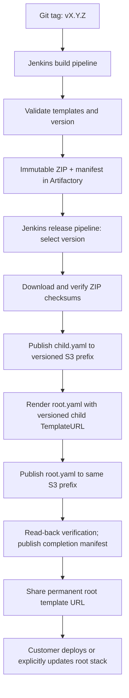

# Immutable CloudFormation release pipeline

Status: Planned
Scope: Jenkins CI, JFrog Artifactory, Amazon S3, root and nested CloudFormation templates.

## Goal

Build one versioned archive of `root.yaml` and `child.yaml` in Jenkins, store it immutably in Artifactory, and publish the selected exact release to an immutable customer-facing S3 prefix using a separate Jenkins release pipeline. Existing customer stacks must never change merely because a new version is published.

## Architecture



Build and release are separate jobs. Release **never rebuilds from Git** and **never calls `cloudformation deploy`** in customer accounts.

## Artifact contracts

Artifactory:

```text
cloudformation-releases/
  1.2.0/
    cloudformation-1.2.0.zip
```

ZIP contents:

```text
root.yaml               # Source template, local child reference
child.yaml              # Source nested template
manifest.json           # Version, commit, Jenkins build, SHA-256 per file, archive format
```

S3:

```text
s3://<distribution-bucket>/releases/
  1.1.0/
    root.yaml
    child.yaml
    manifest.json
  1.2.0/
    root.yaml
    child.yaml
    manifest.json
```

Published `root.yaml` contains an absolute HTTPS `TemplateURL` for `releases/1.2.0/child.yaml` in the same bucket and region. All references must be release-scoped; never point to `latest` or a mutable key. The published root differs from the source root only by the deterministic child URL substitution; record checksums of both published files in the S3 completion manifest.

## Pipeline 1 — Build and archive

1. Trigger on release Git tag `vX.Y.Z`; derive `X.Y.Z` from the tag. **Pass:** valid tag and version not already assigned to different content.
2. Validate root and child YAML with `cfn-lint`; verify root nested-stack resource and local child reference; run CloudFormation template validation when supported. **Pass:** both templates valid and reference contract satisfied.
3. Create reproducible ZIP: fixed paths, ordering and timestamps; produce `manifest.json` with version, Git SHA, source-file SHA-256 and Jenkins build ID. **Pass:** unpacking and rehashing match manifest.
4. Upload to Artifactory under `cloudformation-releases/X.Y.Z/` with overwrite/deletion blocked. Publish JFrog build-info and checksum. **Pass:** remote checksum equals local; conflicting re-publish fails.

## Pipeline 2 — Publish release

Input: immutable `version` (`X.Y.Z`), target AWS account/region/bucket, explicit approval for production distribution.

1. Retrieve the ZIP for `version` from Artifactory. **Pass:** version and archive identity match expected release.
2. Verify manifest, source-file checksums, Git commit metadata and ZIP integrity. **Pass:** no missing, extra or modified template entries.
3. Render a release-specific root template; set child `TemplateURL` to the exact S3 HTTPS key for this version. Revalidate published root and child, including nested-stack link. **Pass:** URL points to `releases/X.Y.Z/child.yaml` and contains no local/mutable reference.
4. Upload `child.yaml` first, then rendered `root.yaml`, using create-only S3 writes (for example, `PutObject` with `If-None-Match: *`). For an existing key, read back and compare expected checksum; accept identical bytes, reject conflicts. **Pass:** published bytes verified, no overwrite.
5. Verify S3 objects are retrievable by the intended customer/CloudFormation access path; check hashes and template validity. **Pass:** customer launch URL and nested-template URL both accessible.
6. Upload `manifest.json` **last** as the completion marker, also create-only. Only advertise releases with a verified completion manifest. **Pass:** complete release is discoverable, incomplete one is not.
7. Output permanent `root.yaml` HTTPS URL, version, archive digest and S3 object checksums. **Pass:** release traceable to Artifactory ZIP and Git commit.

## Immutability and security

- **Artifactory:** disallow artifact overwrite and deletion of released versions; limit publisher permissions; retain checksums/build-info.
- **S3:** enable bucket versioning; enforce create-only conditional writes with IAM/bucket policy; deny overwrites/deletes to pipeline role. Consider Object Lock with retention if regulatory or adversarial tamper resistance is required (requires bucket-level design).
- **Secrets:** Jenkins credentials/role assumption, no static credentials in the archive or logs; least-privilege permissions to versioned prefix.
- **Release identity:** version is never reassigned. Do not silently rewrite the published root or nested URL.
- **Access:** design and test cross-account nested-template download permissions; do not assume a private publisher bucket is readable from customer accounts.
- **Rollback:** publish a new version or have the customer explicitly deploy a previous immutable root URL; releasing a version alone does not update existing stacks.
- **Concurrency:** serialize per version or rely on conditional writes; handle racing publishers as content-compare conflicts. Interrupted releases can safely retry.

## Customer and Marketplace behavior

- New customers can launch the root template of the selected version.
- Existing customer root and nested stacks do not auto-update when a new S3 prefix is published.
- Customer upgrades require an explicit root stack update; preview CloudFormation change sets, particularly potential replacements.
- A future root-stack update must not unexpectedly switch child versions: each released root embeds the same-version child URL.
- If distributed as an **AWS Marketplace CloudFormation product**, account for its nested-template packaging/parameter and version-publication requirements separately. Uploading to publisher S3 does not itself publish a new Marketplace product version.

## Delivery tasks

- [ ] Add Jenkins build job (tag validation, `cfn-lint`, manifest, reproducible archive).
- [ ] Configure immutable Artifactory release repository and build-info.
- [ ] Add Jenkins release job (version input, approval, download and checksum gate).
- [ ] Add deterministic root URL rendering and post-render validation.
- [ ] Configure S3 versioned-prefix permissions, conditional writes and read-back verification.
- [ ] Add customer-access test for both root and nested templates.
- [ ] Add release completion manifest and permanent launch URL output.
- [ ] Document manual upgrade/rollback and Marketplace variant if needed.
- [ ] Add integration tests for release pipeline idempotency and failure recovery.

## Acceptance tests

| Scenario | Expected |
|---|---|
| Build `v1.2.0` | Exactly one immutable archive with manifest in Artifactory |
| Rebuild `1.2.0` with different bytes | Rejected |
| Release `1.2.0` | Versioned S3 child and root are published; root links to child 1.2.0 |
| Retry release `1.2.0` | Succeeds without modifying existing identical objects |
| Upload conflicting object for `1.2.0` | Fails closed |
| Fail after publishing child only | No completion marker; retry safely resumes |
| Release `1.3.0` | All `1.2.0` keys remain unchanged |
| Customer launches `1.2.0` | CloudFormation creates root and nested child stacks |
| Customer leaves `1.2.0` running | Publishing `1.3.0` does not modify stacks |
| Customer opts to upgrade | Change set compares new template before update |

## Open decisions

1. **Version source:** Git tag `vX.Y.Z` assumed; decide release candidate/prerelease policy.
2. **Artifact name/repository:** confirm JFrog repository and retention permissions.
3. **S3 distribution:** bucket/region(s), cross-account access mechanism, and whether URLs must be Marketplace-compatible.
4. **Pipeline approval:** who may publish production releases; whether promotion from staging is required.
5. **Cryptographic provenance:** SHA-256 in manifest is integrity checking; decide whether manifest signatures/attestations are needed for stronger supply-chain guarantees.
6. **CloudFormation packaging:** if Lambda assets or additional nested templates are introduced, extend upload/URL rewrite to package every dependent artifact immutably.

## Alternatives — selective CloudFormation resource deployment

CloudFormation has **no CLI flag to deploy only arbitrary selected resources** from a template or execute a subset of a change set. Select a deployment boundary or model optional resources explicitly; preview modifications through a change set.

| Alternative | How | Advantages | Trade-offs | Best fit |
|---|---|---|---|---|
| **A. Conditions + parameters** | Resource-level `Condition`; customer supplies feature flags during root-stack deployment/update | Single installation URL, explicit optional features, same root/child artifact | Conditions must be designed in template; turning a flag off can delete previously created resources; dependency and output references require care | Select optional features at installation |
| **B. Nested stacks** | Split resource groups into nested child templates; root conditionally includes `AWS::CloudFormation::Stack` resources or passes child parameters | Modular templates; root coordinates one installation and lifecycle | Nested stacks remain parent-managed; changes should flow through root; disabling a nested stack can delete it | Optional resource groups needing unified lifecycle |
| **C. Separate standalone stacks** | Publish one immutable template per independently deployable module; deploy/update each stack separately | Independent deployment, upgrades and lifecycle | More stack orchestration; parameters, outputs and cross-stack exports/imports require dependency management | Customers independently install or upgrade modules |
| **D. Incremental stack update (not resource selection)** | Deploy an updated template or create/execute a change set | CloudFormation normally updates only changed or impacted resources, even if the full template is supplied | Cannot choose arbitrary operations from the change set; replacements and dependency effects still possible | Update existing deployments without unnecessary modifications |

**Default:** Preserve immutable root + child nested-stack release artifacts and full root-stack deployments. If selective initial installation is needed, use **A** for feature flags or **B** for optional nested modules. Choose **C** only when truly independent customer deployments/upgrades are required. **D** applies to every approach; it is not a selection mechanism.

### Compatibility with immutable releases

- Keep selection parameters/conditions inside versioned templates stored in Artifactory and S3; parameters are supplied per customer deployment, never generated as different artifacts for a given release version.
- If using **B**, publish all optional children under the same immutable version prefix; root references only same-version child URLs. Expand the ZIP manifest and release pipeline to include every child template.
- If using **C**, publish each module's versioned template and dependency/installation contract; avoid assuming one root launch URL owns all resources.
- Never toggle off a condition as a way to skip updates to an existing resource: it may remove the resource from the stack. Evaluate `DeletionPolicy`, `UpdateReplacePolicy` and dependency effects where appropriate.
- Run a change set before production updates; do not assume an unchanged resource is always unaffected by an update to a dependency.

### Added implementation tasks

- [ ] Decide selective installation versus selective update; choose **A**, **B** or **C** only if required.
- [ ] Define customer-facing selection parameters, defaults and dependencies for conditional resources/modules.
- [ ] Validate each supported resource selection and its stack-update/removal behavior using change sets.
- [ ] For optional children or standalone modules, extend immutable archive manifest, S3 publishing and customer URL contracts.
- [ ] Test upgrades across different parameter combinations, including accidentally disabled resources and replacements.

### Added acceptance tests

| Scenario | Expected |
|---|---|
| Initial installation with optional feature off | Feature resource/module absent; rest deployed |
| Initial installation with optional feature on | Selected resources/module deployed with same-version child references |
| Update unchanged parameters and resources | Change set contains no unrelated modifications |
| Turn feature off on existing stack | Deletion/retention behavior documented and previewed; no accidental removal |
| Independent module upgrade (if C) | Only targeted standalone stack updated, explicit shared dependencies respected |
