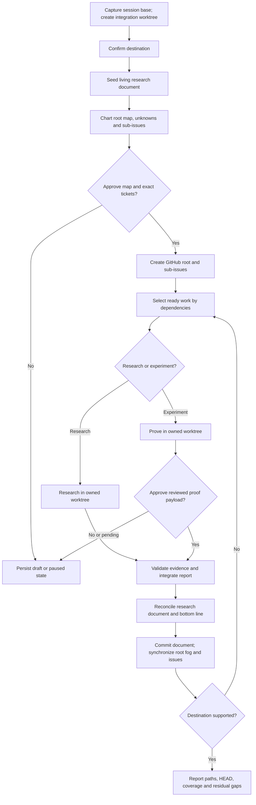

# Research Wayfinder: GitHub map, worktrees, and living research

Status: Planned
Scope: `plugins/wf/skills/research/`, GitHub Wayfinder tracking, local Git worktrees, research document synthesis, tests and documentation.

## Goal

Rename Research `Define` to `Wayfinder` and give it the same persistent execution model as Design Wayfinder. Chart a destination, track unknowns and risks in a GitHub root map issue, use approved sub-issues for factual research and experiments, execute in owned worktrees, and incrementally update one living research document.

Research remains evidence-gathering, not architecture decision-making or implementation. Reuse Design Wayfinder's GitHub, Git, approval and recovery contracts rather than copying their mechanics.

## Scope and structure

```text
plugins/wf/skills/research/
  SKILL.md
  wayfinder/
    wayfinder.md                   # renamed from playbooks/define.md
    questioning.md                 # moved from references/define-questioning.md
    living-document.md             # research-specific incremental synthesis rules
    research-map.template.md       # GitHub root issue body and topic fields
    research-document.template.md  # living output structure
  agents/                          # unchanged evidence agents
  explore/                         # unchanged
  how/                             # unchanged
  why/                             # unchanged
  cloud/                           # unchanged
  web/                             # unchanged
  references/                      # shared research references only
```

- Rename route `Define` → `Wayfinder` in `SKILL.md`; use `/research wayfinder <prompt-or-map-path>` or `Route: Wayfinder`. Preserve evidence-route routing and agent contracts.
- Move Wayfinder-only questioning and templates into `wayfinder/`; remove empty `playbooks/` and `templates/`.
- `wayfinder.md` owns destination, frontier, tracker, dispatch, approvals, worktree lifecycle and synchronization.
- `living-document.md` owns merging results into the existing research document. It is a procedure, not a second document template.
- `research-map.template.md` defines **the GitHub map issue body** and sub-issue fields, not a competing local map.
- `research-document.template.md` defines the researcher-facing report: Bottom line, What we did, Open questions / decisions, Remaining work, Next steps, References.
- Reference `writing-style/references/bottom-line.md` through the writing-style skill when synthesizing conclusions. Do not copy its rules.
- Update all route links and callers. Keep route names out of the frontmatter description if not needed for discovery.

## Persistent outputs and ownership

```text
GitHub issues
  Root issue: wayfinder:map                   # authoritative workflow state/fog
    Research sub-issue: wayfinder:research    # one sharp research question
    Experiment sub-issue: wayfinder:experiment # one falsifiable claim

Local integration worktree
  docs/ongoing/<slug>-research.md            # living synthesized document
  docs/research/<slug>/<topic-slug>.md        # detailed evidence reports
  docs/prototype/<slug>/<experiment>/report.md # reproducible proof report
```

**Do not maintain another active Markdown research map.** The GitHub root issue owns destination, unresolved unknowns, risks, progress and issue dependency state. Sub-issues own concrete tasks and their results. The living document owns the conclusion and its referenced evidence. Topic reports/proof reports remain independently readable and linked, not copied into the living document.

## GitHub root map

Create one GitHub issue with label `wayfinder:map` following Design Wayfinder's ticket-approval and tracker operations. Proposed body:

```markdown
## Destination
<research question and outcome that the evidence must support>

## Notes
<context, constraints, versions, required sources>

## Document and branches
- Document: docs/ongoing/<slug>-research.md
- Integration branch: wayfinder/<slug>; HEAD: <sha>
- Session base branch/SHA: <branch>/<sha>
- Worktree: <absolute path>; ownership record: <durable path>

## Findings so far
- [<topic title>](<report or sub-issue link>) — <supported conclusion and status>

## Not yet specified
- <stable unknown/risk ID>: <unknown, risk, or conflicting evidence>
  - Status: <open | blocked | pending approval | resolved>
  - Linked work: <sub-issue when actionable>
  - Next action: <what can settle it>

## Out of scope
- <excluded work and reason>
```

`Not yet specified` is the **single fog-of-war register** for all unresolved unknowns and material risks, including those represented by active sub-issues. It includes coarse unformulated areas and sharp known gaps; a question graduates to a sub-issue when actionable. Do not remove an unknown until supported by integrated evidence or an explicit user scope decision. Preserve stable IDs, blockers, status and links across updates. Keep excluded work out of fog.

Use the existing `wayfinder:map`, `wayfinder:research`, and `wayfinder:experiment` labels; reuse parent/sub-issue, blocked-by, claim/release, comment and close operations from Design Wayfinder. Use the WF installer labels-only repair procedure if labels are absent.

## Sub-issue contract

Each proposed sub-issue records:

- **Question:** one sharp factual question, or one falsifiable hypothesis with confirmation/refutation criteria.
- **Unknowns:** root-map unknown/risk IDs it resolves.
- **Work:** helper `research` or `prove`, scope, target, exact output path, and expected result.
- **Research scope:** for research, select Explore/How/Why/Cloud/Web, target, version and lens where applicable.
- **Blocked by:** prerequisite sub-issue titles/relationships; only dispatch after prerequisites have been integrated.
- **Part of:** parent root map; result section added after execution.
- **Result:** source revision, owned worktree/branch, findings, evidence links, proof limits, approval/integration state and next action.

Propose the root and sub-issues as temporary clickable Markdown drafts before creating them. **Explicit approval of each exact proposal is mandatory**. Destination approval, previous approval, silence or passing checks is not ticket approval. Changed proposals require fresh review. A mapped/approved issue may then dispatch its ready factual work automatically, without a second dispatch question. Existing unchanged approved issues may be resumed.

Research questions with partial/blocked/inconclusive results remain open; their dependents remain blocked. Never close an issue on an unsupported answer.

## Worktree and branch conventions

Use **the exact prefixes from Design Wayfinder**, through the existing `git` skill Branches, Worktrees and Integration procedures:

| Work | Branch name | Checkout |
|---|---|---|
| Living research/map integration | `wayfinder/<slug>` | Dedicated document integration worktree |
| Research sub-issue | `research/<slug>` | Owned topic result worktree |
| Experiment or verification | `prove/<slug>` | Owned proof result worktree |

Example: `wayfinder/scip-indexing`, `research/csharp-indexing`, `research/typescript-indexing`, `prove/cross-language-lookup`.

1. Capture original harness root, repository, session base branch/SHA before changing worktrees. Keep caller's working branch untouched.
2. Create the dedicated `wayfinder/<slug>` branch and owned worktree from the session base; persist ownership outside disposable worktrees. Seed and locally commit `docs/ongoing/<slug>-research.md`.
3. Create each result worktree from a **pinned current integration HEAD**. Independent topics may start from the same pinned HEAD; dependent topics wait for prerequisite integration.
4. Pass exact absolute report destinations under the result worktree to the evidence route/Prove. The Research router remains the writer of research reports; Wayfinder owns Git commits and integration.
5. Check citations, provenance, claim criteria, status, report identity and incoming diff. Integrate verified **research report-only** payloads automatically. Worktree source edits are not production fixes.
6. For Prove, retain runnable reproduction state, patches and report in its worktree. Show the exact prototype payload, outcome and limits for **explicit approval before integration**. A passed test is not approval. Pending proof remains in its worktree; record approval against the actual payload identity.
7. Commit eligible result artifacts and perform local integration with drift/ancestry checks. Restore unrelated production-source edits before constructing the payload. Do not push, open a PR, merge into the session base, or ship implementation.
8. Clean an owned worktree only after verified integration, document synchronization and completion of all required reproduction/review consumers. Retain blocked, rejected or approval-pending worktrees.

## Workflow



Research dispatch uses the router's existing Frame, Routing and Spawning-agents pipeline. Do not recursively invoke Research or add an agent role for Wayfinder; do not change standalone Explore, How, Why, Cloud or Web delivery defaults. Batch independent research when safe; serialize integration/document writes. Prove is called through its own skill using exact claim, criteria, environment and destinations. Manual judgment and explicit prototype approval stay with the user.

## Living research document

New `wayfinder/research-document.template.md`:

```markdown
# [Research] <title>

## Bottom line
- **<finding>** <why it matters> <action or status>

## What we did
- **<subject>:** <verification method, environment, result, limits>

## Open questions / decisions
- <question requiring a human decision, if any>

## Remaining work
- <specific unproven claim and required verification, or no remaining work>

## Next steps
1. <action or handoff>

## References
- [<research topic report>](../research/<slug>/<topic>.md)
- [<experiment report>](../prototype/<slug>/<experiment>/report.md)
```

Use the writing-style Bottom line procedure: **What did we find? So what? Now what?** Lead with bold findings; mark unconfirmed conclusions **Not confirmed**. Use clear, concise source-grounded language. The canonical document embeds conclusions, not complete reports; References link every supporting research/proof report via working repository-relative paths.

`wayfinder/living-document.md` owns incremental reconciliation:

1. Read latest document and newly integrated evidence. Identify each supported conclusion, conflict, unknown and canonical source identity.
2. Update matching subjects/sections in place. Preserve verified findings and human decisions; supersede only with stronger evidence. Avoid duplicated findings, references and outcome rows.
3. Keep incomplete/conflicting claims in root `Not yet specified` and Remaining work, without portraying pending prototype observations as confirmed integrated outcomes.
4. Update Bottom line, What we did, Remaining work, Next steps and References; ensure the recommendation matches verification status.
5. Validate relative links and report existence. Commit the document on `wayfinder/<slug>`; then synchronize GitHub issue results/fog. Persist the last reconciled evidence/HEAD so reruns are idempotent.

Synchronize after every integrated result, session pause, human choice, approval, and resume. If synchronization fails, persist the pending step and retry without duplicating work.

## Resume and compatibility

- Resume from existing root issue and persisted branch/worktree/HEAD identities. Verify refs, ancestry, report files, approvals and last sync before dispatch.
- Recover pending approved proof integration before running new dependent work; do not regenerate an unchanged candidate.
- If refs or local evidence are missing, report a blocker. Never invent remote artifact links or silently replace worktrees.
- Migrate legacy `docs/ongoing/<slug>-research-map.md` into the GitHub root issue only with verified identity and evidence links. Preserve legacy files/history and avoid a second active source of truth.
- Existing standalone evidence routes and explicit caller output destinations remain compatible.

## Files and integration points

- **Move/edit:** `plugins/wf/skills/research/SKILL.md`, `playbooks/define.md`, `references/define-questioning.md`, `templates/research-map.md`.
- **Add:** five Wayfinder-local files listed in Scope and structure, including the moved/renamed playbook, questioning and map template.
- **Reuse:** `plugins/wf/skills/design/playbooks/wayfinder.md`, its `references/github.md` GitHub operations, and the shared `git` skill. Extract genuinely shared GitHub operations to a shared owner if a direct cross-skill resource would violate Research's local-resource contract; do not fork code or duplicate procedures.
- **Document:** root `README.md`, `plugins/wf/README.md`, architecture-records and other route references, plus `docs/adr/research-is-a-router.md` / architecture index if the changed contract requires ADR revision.
- **Tests:** update `tests/wf/research/test_define_routes.py`, `test_contracts.py`, other caller/route checks, and add workflow contract tests.

## Validation and acceptance

- [ ] `Wayfinder` route resolves from explicit invocation; `Define` links/names are migrated without changing evidence routes or agent prompts.
- [ ] All Wayfinder-specific resources live in `research/wayfinder/`; internal links resolve; no duplicate maps/templates.
- [ ] Root `wayfinder:map` issue owns destination and **all unknowns/risks**; approved research/experiment sub-issues have valid parents and blockers.
- [ ] GitHub map/sub-issue drafts require explicit approval before creation; approved ready factual work dispatches automatically.
- [ ] Branches/worktrees use `wayfinder/<slug>`, `research/<slug>`, `prove/<slug>`; original branch untouched.
- [ ] Research integrates verified artifact-only results automatically; Prove payload remains pending until explicitly approved.
- [ ] Living document updates Bottom line, findings, remaining work, next steps and working evidence links without duplicate or unsupported conclusions.
- [ ] Partial, blocked, conflicting and rejected work remains visible/resumable; dependents do not unblock prematurely.
- [ ] Recovery verifies refs, state and content identities; repeated synchronization/integration is idempotent.
- [ ] No automatic push, PR, merge into session base, production implementation or Confluence publication.
- [ ] Research tests and markdown link/lint checks pass.

## Completion contract

Report root GitHub issue, document path, local integration branch/HEAD, integrated topic/proof links, open unknowns/risks, pending approvals, and blockers. Research is complete only when the destination has sufficient supported evidence or the user confirms remaining gaps cannot change its answer. Any unresolved claim must remain marked as such.
