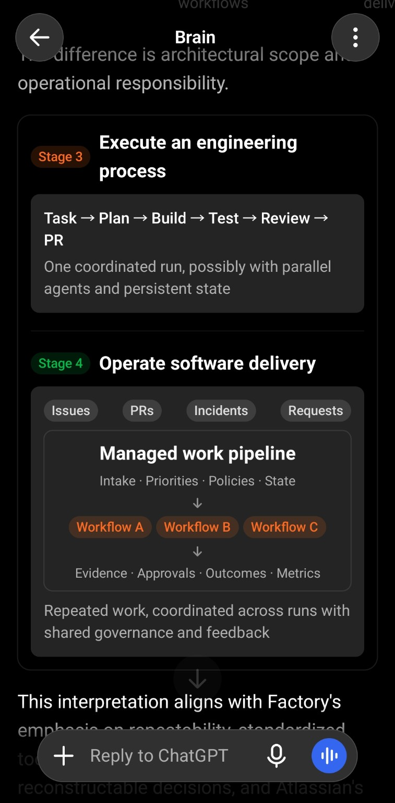

# Research: From Prompt Engineering to Agentic Software Factories

**Research date:** October 25, 2026  
**Scope:** The five named AI-skills creators, two open-source orchestration projects, Warp and Warp Factories, and Atlassian Jira / Teamwork Graph / AI SDLC guidance.  
**Method:** Review of the supplied project documentation and first-party product material; GitHub stars and forks retrieved from the GitHub repository API on the research date.

## Executive finding

The useful distinction is **instructions → bounded agent task → coordinated workflow → managed software production**. Stage 3 automates execution of an engineering process; Stage 4 operates repeatable delivery across work items, workflows, policies, measurement, and improvement. Factories compose workflows rather than replace them.

This four-stage model is a **presentation taxonomy, not an industry standard, certification, or necessary linear maturity path**. Event triggers, durable state, and human approvals may exist in Stage 3 workflows; none alone establishes a factory. Anthropic distinguishes predefined *workflows* from dynamically directed *agents*. Microsoft documents durable, event-driven agent workflows. Factory and Atlassian describe the factory at the broader production/operating-model level. [Anthropic](https://www.anthropic.com/research/building-effective-agents) · [Microsoft Durable Extension](https://learn.microsoft.com/en-us/agent-framework/hosting/durable-extension) · [Factory](https://factory.com/articles/what-is-a-software-factory) · [Atlassian AI SDLC playbook](https://www.atlassian.com/blog/ai-at-work/ai-sdlc-transformation-playbook)

## Stage 1 — Prompt & Context Engineering

- **What changes:** The AI moves from isolated prompts to reusable instructions, repository rules, documentation, and connected organizational knowledge.
- **Control:** The human drives execution and supplies the relevant context.
- **Typical mechanisms:** Skill files, project instructions, terminology, retrieval, connected knowledge sources.
- **Why this is a separate stage:** Better context improves decisions, but it does not confer authority to take action or run a multi-step process.
- **Resources:** The `context-engineering` skill in [Addy Osmani's Agent Skills](https://github.com/addyosmani/agent-skills); domain modeling and agent writing in [Matt Pocock's Skills](https://github.com/mattpocock/skills); [Atlassian Teamwork Graph](https://www.atlassian.com/platform/teamwork-graph), which relates issues, code, documents, people, and decisions under permissions.

**Evidence-based distinction:** Teamwork Graph is a **context foundation**, not on its own a software factory. Atlassian uses it to make work and code context available to agents through apps, MCP, and CLI. [Atlassian Teamwork Graph](https://www.atlassian.com/platform/teamwork-graph) · [Atlassian playbook](https://www.atlassian.com/blog/ai-at-work/ai-sdlc-transformation-playbook)

## Stage 2 — Agentic Development

- **What changes:** A coding agent can inspect a repository, change code, use tools, run tests, and retry after failures.
- **Control:** The agent drives execution of a bounded engineering task; a developer still supplies the task and decisions that need human judgment.
- **Typical mechanisms:** Tool access, TDD, debugging loops, browser/UI verification, code-review subagents, parallel attempts.
- **Why this is a separate stage:** The AI now *acts on the environment* and verifies outcomes instead of returning advice or generated text.
- **Primary example:** [Lauren Tan (poteto)'s pstack](https://github.com/cursor/plugins/tree/main/pstack). Its `poteto-mode` routes to engineering disciplines such as architecture, adversarial investigation, TDD, parallel `swarm`/`arena`, and PR babysitting. This is primarily an agentic engineering toolkit rather than a persistent SDLC runtime.
- **Important nuance:** pstack also includes an **optional, dormant** `benny` automation pack for Slack-triggered triage and bounded bug fixes. That adds automated work intake when explicitly installed on Cursor Automations, but a trigger alone does not establish a factory-wide operating model. [pstack README](https://github.com/cursor/plugins/blob/main/pstack/README.md) · [benny automation specification](https://github.com/cursor/plugins/blob/main/pstack/automations/benny/FOR_AGENTS.md)

## Stage 3 — Agentic Workflows

- **What changes:** Agent tasks become a coordinated, bounded engineering process (for example: specify → implement → verify → review → PR). A workflow need not cover every SDLC phase.
- **Control:** A human, event, or schedule may initiate a run; the workflow coordinates steps, agents, dependencies, quality gates, and approvals. Agents may make dynamic choices within those steps.
- **Typical mechanisms:** Reusable process skills, task graphs, parallel worktrees, typed handoffs, retries, durable checkpoints, event triggers, and evidence gates.
- **Why this is a separate stage:** The unit of automation shifts from **one engineering task** to **a coordinated process with a defined outcome**. Long-running, event-triggered, or durable execution does not by itself imply a factory.
- **Industry nuance:** Anthropic defines an agentic workflow more broadly as LLMs/tools orchestrated through predefined code paths. Our Stage 3 narrows that concept to engineering workflows. Microsoft explicitly supports durable agent workflows, checkpoints, external events, and human-in-the-loop waits. [Anthropic](https://www.anthropic.com/research/building-effective-agents) · [Microsoft](https://learn.microsoft.com/en-us/agent-framework/hosting/durable-extension)

### Sources classified primarily at Stage 3

1. **[Matt Pocock — Skills](https://github.com/mattpocock/skills).** `/to-spec`, `/to-tickets`, `/implement`, and `/implement-spec` coordinate work from a spec through task-graph implementation, parallel subagents, and review. The documentation deliberately emphasizes small composable human-invoked skills rather than an always-on process owner. **Reason:** process-level coordination exists, but the repository does not document a shared cross-work-item delivery operating system with factory-wide governance and measurement.
2. **[Affaan Mustafa — Everything Claude Code (ECC)](https://github.com/affaan-m/ECC).** A broad agent harness with specialized subagents, reusable skills, rules, hooks, and orchestration scripts. Its README reports 71 agents, 311 skills, and 97 maintained command shims at the time of review. **Reason:** substantial execution infrastructure, but skill/harness breadth does not alone establish managed cross-run production, shared governance, and measured outcomes.
3. **[Garry Tan — gstack](https://github.com/garrytan/gstack).** Explicit sprint sequence: Think → Plan → Build → Review → Test → Ship → Reflect. Role-oriented engineering, product, design, QA, and release skills, with parallel sprint support. **Reason:** coherent multi-phase engineering process; the documented scope primarily coordinates bounded runs rather than a managed portfolio of work.
4. **[Addy Osmani — Agent Skills](https://github.com/addyosmani/agent-skills).** Twenty-five reusable skills and nine lifecycle commands across Define → Plan → Build → Verify → Review → Ship. `/build auto` can plan and complete the implementation in a bounded autonomous pass after approval. **Reason:** workflow composition and verification gates are present; the collection is not itself documented as a managed production platform.
5. **[Super Simple Software Factory (SSSF)](https://github.com/antshc/super-simple-software-factory/tree/main/.claude/skills/sssf).** Deterministic Python owns phase sequencing, typed envelopes, gate checks, retries, and SQLite run traces while coding agents work inside bounded steps. The documented v1 uses Pi; Claude Code integration is a stub and the visualizer is planned for a later pass. **Reason:** an agentic workflow engine / factory prototype with durable traces, but the reviewed skill does not establish cross-work-item governance, operational measurement, and managed delivery as a service.
6. **[EricTechPro — super-board](https://github.com/EricTechPro/super-board).** GitHub Project board as durable task state, autonomous Build → QA → Review waves, merge guards, evidence, and resume. It is started with `/super-board run`, which can drain a board. **Reason:** a factory-leaning case with board-level durable work and guardrails. Its user-started default is not disqualifying; classify provisionally because broader production policies, measurement, and feedback are not fully established by the reviewed documentation.

**Boundary case:** pstack spans Stage 2 and parts of Stage 3 because `poteto-mode` coordinates specialized practices and PR follow-up. The optional `benny` automation adds event-driven intake, a capability also available in Stage 3.

## Stage 4 — Agentic Software Factories

- **What changes:** A managed production system coordinates repeatable software delivery across incoming work items and multiple workflows, with shared policies, traceable outcomes, and systematic measurement.
- **Control:** People define intent, governance, risk boundaries, and approval authority; the system handles standardized intake, scheduling, isolated execution, recovery, handoffs, and evidence within those boundaries.
- **Typical mechanisms:** Human requests, APIs, webhooks or schedules; durable work-item state; orchestration and recovery; shared context and permissions; policy/CI gates; audit and operational metrics; evaluation-driven improvements.
- **Why this is a separate stage:** The unit of management becomes **delivery as a repeatable, governed service across runs**, rather than a single workflow execution. Automated triggers and durability are common but neither necessary nor sufficient individually. A factory can hand off reviewed PRs without owning production deployment.
- **Industry nuance:** Software factories predate AI; the core idea is standardized, repeatable production. Agentic factories add tool-using agents to that operating model. [Factory](https://factory.com/articles/what-is-a-software-factory) · [Atlassian](https://www.atlassian.com/blog/ai-at-work/ai-sdlc-transformation-playbook)

### Sources classified primarily at Stage 4

1. **[Warp Factories](https://www.warp.dev/factories)** (separate from the general [Warp open-source agentic development environment](https://github.com/warpdotdev/warp)). Its first-party documentation describes factories-as-code, triggers from existing tools, a foreman-led triage → spec → implement → verify → ship → monitor path, sandboxes, agent/model choice, evaluations, benchmarks, approvals, and self-improvement. **Reason:** it connects multiple work sources to a managed agent delivery system, shared definitions, governance, visibility, and run evaluation. **Boundary:** Warp says its factory normally returns reviewed PRs and never merges on a team's behalf; its factory dashboard is not evidence of production monitoring for every application. **Maturity caveat:** early access; claims are not independent performance verification. [Warp overview](https://docs.warp.dev/factories/)
2. **[Atlassian AI SDLC transformation playbook](https://www.atlassian.com/blog/ai-at-work/ai-sdlc-transformation-playbook)**, with [Jira](https://www.atlassian.com/software/jira), [Rovo](https://www.atlassian.com/software/rovo), and [Teamwork Graph](https://www.atlassian.com/platform/teamwork-graph). The playbook integrates connected context and measurement with planning, design, development, review, and proactive maintenance. Jira supplies tracked work and approvals; Teamwork Graph supplies permission-aware organizational context. **Reason:** this is a Stage 4 *operating-model architecture*, not evidence that Teamwork Graph alone is a complete factory product. Atlassian reports internal governed agent loops and outcomes, but these are vendor-reported results.

### Factory evaluation dimensions (not a binary checklist)

| Dimension | Workflow-level capability (Stage 3 possible) | Factory-level operating concern (Stage 4) |
| --- | --- | --- |
| Unit of management | One bounded run | Stream/portfolio of work items and repeated runs |
| Intake | Manual, API, event, or scheduled start | Standardized prioritization, routing, and identity across work sources |
| Orchestration | Steps, agents, retries, fan-out/fan-in | Coordinating reusable workflows, dependencies, capacity, and recovery across work |
| State | Can persist sessions and checkpoints | Traceable work items, decisions, evidence, and outcomes across runs |
| Governance | Per-run tests and approval gates | Consistent risk policies, permissions, approvals, and auditability |
| Measurement | Execution success, duration, cost | Delivery throughput, lead time, quality, cost, and business outcomes |
| Feedback | Learn from a completed run | Evaluate patterns and improve reusable instructions, tests, and policies under review |

This comparison is a **reasoned architectural heuristic**, not a formal industry classification. Automated event intake is useful but does not alone make a factory. Production deployment/monitoring and self-modification are optional scope choices, not universal prerequisites. [Microsoft](https://learn.microsoft.com/en-us/agent-framework/hosting/durable-extension) · [Warp](https://docs.warp.dev/factories/) · [Factory](https://factory.com/articles/what-is-a-software-factory) · [Atlassian](https://www.atlassian.com/blog/ai-at-work/ai-sdlc-transformation-playbook)

**Visual reference (not a slide asset):** The attached Stage 3 vs. Stage 4 comparison captures the intended conceptual hierarchy. It includes mobile UI chrome; do not reuse it directly as a production slide.

## GitHub popularity — five named skills creators

**Snapshot date:** October 25, 2026. **Primary ranking: stars, descending.** Fork rank is shown separately because its order differs.

| Stars rank | Creator | AI-skills repository | Stars | Forks | Forks rank | Primary stage |
| ---: | --- | --- | ---: | ---: | ---: | --- |
| 1 | Matt Pocock | [mattpocock/skills](https://github.com/mattpocock/skills) | 302,868 | 25,471 | 2 | 3 |
| 2 | Affaan Mustafa | [affaan-m/ECC](https://github.com/affaan-m/ECC) | 288,418 | 42,762 | 1 | 3 |
| 3 | Garry Tan | [garrytan/gstack](https://github.com/garrytan/gstack) | 137,622 | 20,402 | 3 | 3 |
| 4 | Addy Osmani | [addyosmani/agent-skills](https://github.com/addyosmani/agent-skills) | 110,342 | 11,516 | 4 | 3 |
| 5* | Lauren Tan (poteto) | [cursor/plugins/pstack](https://github.com/cursor/plugins/tree/main/pstack) | 13,971* | 1,396* | 5* | 2 → 3 |

**Critical metric caveat:** pstack is a **subdirectory** of `cursor/plugins`. Its stars and forks are the metrics for the **entire Cursor Plugins repository**, not for pstack itself. The fifth row is a labeled proxy, **not a valid apples-to-apples individual creator ranking**. No separate public `poteto/pstack` repository was found at the tested repository path. Repository stars and forks represent popularity/interest, not code correctness, adoption, or SDLC maturity.

The stars ordering is Matt → Affaan → Garry → Addy → Cursor Plugins proxy. The forks ordering is **Affaan → Matt → Garry → Addy → Cursor Plugins proxy**.

### Grouped by primary evolution stage

- **Stage 1:** No listed creator is *only* a prompt/context resource. All five contain reusable instructions or context practices.
- **Stage 2:** Lauren Tan / pstack (primary emphasis on agentic engineering rigor and tool-using coding; Stage 3 orchestration features and optional automations also exist).
- **Stage 3** (ordered by stars): Matt Pocock; Affaan Mustafa; Garry Tan; Addy Osmani. SSSF and super-board are additional workflow-oriented projects, not part of the five-creator ranking.
- **Stage 4:** No one of the five standalone skills repositories is best classified as a complete persistent software factory. Warp Factories and Atlassian's AI-native SDLC operating model are the clearest Stage 4 references in this source set.

**Other GitHub repositories (not part of the five-creator ranking):** [warpdotdev/warp](https://github.com/warpdotdev/warp) had 65,692 stars / 5,700 forks; [EricTechPro/super-board](https://github.com/EricTechPro/super-board) had 489 / 143; [antshc/super-simple-software-factory](https://github.com/antshc/super-simple-software-factory) had 0 / 0. The Warp repository metrics cover its broader open-source client, **not solely Warp Factories**.

## What these sources actually support

### Directly observable in the sources

- The five named skills sources all include actionable engineering skills; several include explicit development life-cycle workflows, agents, or subagents.
- Matt, Addy, Garry, and Affaan document repeatable multi-step engineering processes.
- SSSF documents deterministic phase control, typed handoffs, and verification gates.
- super-board documents board-driven task waves and a start/resume command.
- Warp documents connected work sources, coordinated agents, reviewed-PR output, shared configuration, and run evaluation. It does not claim to merge on behalf of the user.
- Atlassian presents context + measurement + workflow shifts as two connected requirements of AI-native delivery.

### Interpretations, not independently verified claims

- Placing an individual project in a stage is an architectural inference based on the reviewed documentation, not a vendor-issued certification.
- Repository stars and forks cannot show which project creates higher quality software or which has more active production installations.
- Vendor-reported improvements (such as Atlassian's Teamwork Graph benchmark or Warp's cost stories) should not be treated as independent cross-vendor benchmarks.
- Branding a package a “factory” does not prove standardized cross-work-item delivery, operational governance, measurable results, or production readiness.
- Event-driven durability can be implemented inside workflows; it is not a factory-exclusive boundary.
- A factory's output may be a reviewed pull request; automatic merging, deployment, and production monitoring are not universally required.

## Bottom line

**Facts:** The most-starred standalone skills repository in this set is Matt Pocock's (302,868); the most-forked is Affaan Mustafa's ECC (42,762). The pstack comparison is only a Cursor Plugins repository proxy. The documented open-source skill collections and manually started agent pipelines mainly occupy **Stages 2–3**, while Warp Factories and Atlassian's AI-native SDLC architecture address the broader **Stage 4** operating model.

**Reasoned conclusion:** Stage 3 **executes a defined engineering process**; Stage 4 **operates repeatable software delivery** across work items and workflows with shared governance, traceability, measurement, and reviewed improvement. Event triggers, durable execution, and production integrations are useful supporting capabilities, not a universal pass/fail definition.

## Resource list

### Primary project sources

1. [Lauren Tan / pstack — Cursor Plugins](https://github.com/cursor/plugins/tree/main/pstack) · [automation specification](https://github.com/cursor/plugins/blob/main/pstack/automations/benny/FOR_AGENTS.md)
2. [Addy Osmani — Agent Skills](https://github.com/addyosmani/agent-skills)
3. [Matt Pocock — Skills](https://github.com/mattpocock/skills)
4. [Garry Tan — gstack](https://github.com/garrytan/gstack)
5. [Affaan Mustafa — Everything Claude Code](https://github.com/affaan-m/ECC)
6. [Super Simple Software Factory — SSSF skill](https://github.com/antshc/super-simple-software-factory/tree/main/.claude/skills/sssf)
7. [EricTechPro — super-board](https://github.com/EricTechPro/super-board)
8. [Warp open-source repository](https://github.com/warpdotdev/warp) · [Warp Factories](https://www.warp.dev/factories)
9. [Atlassian Teamwork Graph](https://www.atlassian.com/platform/teamwork-graph) · [Rovo](https://www.atlassian.com/software/rovo) · [Jira](https://www.atlassian.com/software/jira)
10. [Atlassian — The AI SDLC transformation playbook (October 1, 2026)](https://www.atlassian.com/blog/ai-at-work/ai-sdlc-transformation-playbook)

### Conceptual foundation

- [Anthropic — Building effective agents](https://www.anthropic.com/research/building-effective-agents): workflow/agent architectural distinction.
- [OpenAI — Agents guide](https://developers.openai.com/api/docs/guides/agents): tools, state, orchestration, runtime boundaries.
- [OpenAI — Guardrails and human review](https://developers.openai.com/api/docs/guides/agents/guardrails-approvals): checks and human approval boundaries.
- [Microsoft — Agent Framework Durable Extension](https://learn.microsoft.com/en-us/agent-framework/hosting/durable-extension): durable, event-driven workflows and human approvals can be workflow capabilities.
- [Factory — What is a software factory?](https://factory.com/articles/what-is-a-software-factory): standardized repeatable delivery, traceability, measurement, and continuous feedback.
- [Warp — Factories overview](https://docs.warp.dev/factories/): work intake, default agents, handoff to reviewed PR, permissions, and run evaluation.

### GitHub popularity data

- Primary values: GitHub REST repository metadata for [mattpocock/skills](https://api.github.com/repos/mattpocock/skills), [affaan-m/ECC](https://api.github.com/repos/affaan-m/ECC), [garrytan/gstack](https://api.github.com/repos/garrytan/gstack), [addyosmani/agent-skills](https://api.github.com/repos/addyosmani/agent-skills), and [cursor/plugins](https://api.github.com/repos/cursor/plugins), collected October 25, 2026.
