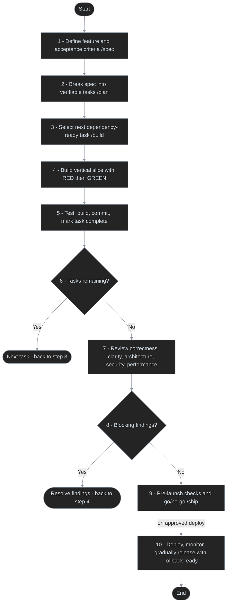
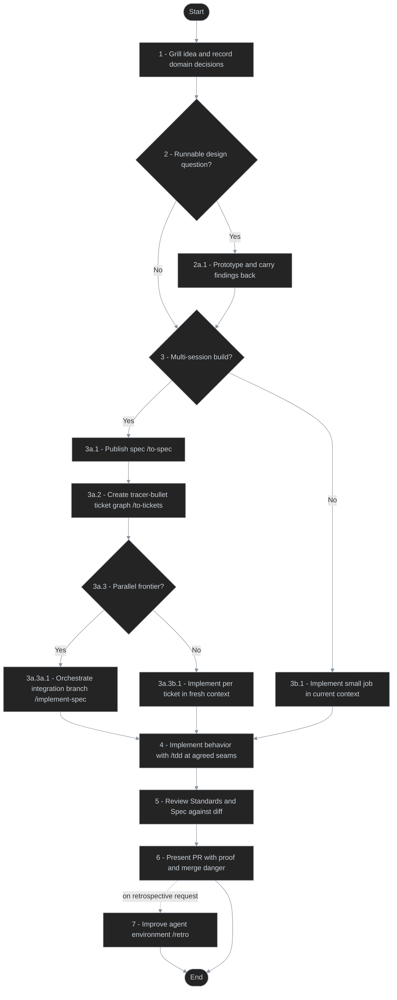
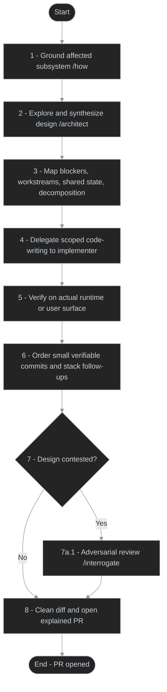

# Feature development lifecycles in agent skill collections

Researched 2026-11-01. These are **documented workflow summaries**, not one universal
workflow assembled from all available skills. Each Mermaid flowchart is top-to-bottom
and follows Brain's [`doc-behavior-diagram`](../../plugins/wf/skills/doc-behavior-diagram/SKILL.md)
conventions. Branches show optional routes; no arrow back to an earlier step implies
automatic retries or continuation.

| Collection | Primary feature flow | Emphasis |
| --- | --- | --- |
| [Addy Osmani — agent-skills](https://github.com/addyosmani/agent-skills) | Spec → Plan → Build → Review → Ship | Incremental delivery, TDD, quality gates, staged rollout |
| [Matt Pocock — skills](https://github.com/mattpocock/skills) | Grill → Spec/Tickets when needed → Implement → Review → PR → Retro | Domain language, tracer-bullet tickets, explicit blockers, fresh contexts |
| [Cursor — pstack](https://github.com/cursor/plugins/tree/main/pstack) | How → Architect → Decompose → Delegate → Verify → PR | Design alternatives, implementation delegation, runtime proof |

### Additional idea-framing and planning skills

These are **optional entry points**, not mandatory steps in every feature flow.

| Collection | Skill | Role |
| --- | --- | --- |
| Addy Osmani | [`interview-me`](https://github.com/addyosmani/agent-skills/blob/main/skills/interview-me/SKILL.md) | Ask one question at a time to discover user intent before the spec when requirements are unclear. |
| Matt Pocock | [`wayfinder`](https://github.com/mattpocock/skills/blob/main/skills/engineering/wayfinder/SKILL.md) | Map and resolve decision tickets for efforts too large or uncertain for one session; hand off to `to-spec` when clear. |
| Cursor pstack | [`in-your-own-words`](https://github.com/cursor/plugins/blob/main/pstack/skills/in-your-own-words/SKILL.md) | Restate the user's goal and underlying problem to check understanding. |
| Cursor pstack | [`sharpen`](https://github.com/cursor/plugins/blob/main/pstack/skills/sharpen/SKILL.md) | Deepen task rigor and rewrite the prompt with better evidence and validation, without expanding its scope. |

## 1. Addy Osmani: spec to safe rollout

The repository explicitly defines `/spec`, `/plan`, `/build`, `/review`, and `/ship`.
`/build` processes the next task; `/build auto` processes all tasks after one plan
approval. Both retain per-task tests, verification, and commits. The review is
five-axis; `/ship` also performs readiness checks and produces a go/no-go decision.
Deployment and progressive flag rollout are covered by the shipping skill, not an
unconditional side effect of the `/ship` command.

**Important variants:** Greenfield adopts this lifecycle directly. Brownfield
begins with codebase context, review, and characterization tests before changing
legacy behavior. Observability is introduced *during* implementation. `ship` is
a readiness decision; the shipping skill specifies monitored staged rollout.

Sources: [`using-agent-skills`](https://github.com/addyosmani/agent-skills/blob/main/skills/using-agent-skills/SKILL.md),
[`adoption-guide`](https://github.com/addyosmani/agent-skills/blob/main/docs/adoption-guide.md),
[`build` command](https://github.com/addyosmani/agent-skills/blob/main/commands/build.toml),
[`review` command](https://github.com/addyosmani/agent-skills/blob/main/commands/review.toml),
[`ship` command](https://github.com/addyosmani/agent-skills/blob/main/commands/ship.toml),
[`shipping-and-launch`](https://github.com/addyosmani/agent-skills/blob/main/skills/shipping-and-launch/SKILL.md).

## 2. Matt Pocock: idea to reviewed implementation

`ask-matt` defines the main route. The initial grilling records domain terms in
`GLOSSARY.md` and decisions in ADRs. A runnable design question can detour through
`prototype` and return with evidence. A small job can use `implement` directly;
a multi-session job becomes `to-spec` and `to-tickets` first. Tickets are vertical
slices with blocking edges. The two implementation modes are alternatives:
`implement` works tickets individually, while `implement-spec` runs ready tickets
in parallel worktrees on an integration branch.

**Review timing:** `implement` invokes TDD and code review **per ticket** and
commits it. `implement-spec` invokes TDD in each implementer and performs one
two-axis review over the combined integration branch, then fixes findings.
`pr` shapes the PR body; it does not by itself merge or deploy. `retro`
proposes better automated checks, navigation, and coding standards. For very
large unclear initiatives, `wayfinder` resolves **decision tickets** before
rejoining at `to-spec`—it does not implement the feature itself.

Sources: [`ask-matt`](https://github.com/mattpocock/skills/blob/main/skills/engineering/ask-matt/SKILL.md),
[`to-spec`](https://github.com/mattpocock/skills/blob/main/skills/engineering/to-spec/SKILL.md),
[`to-tickets`](https://github.com/mattpocock/skills/blob/main/skills/engineering/to-tickets/SKILL.md),
[`implement`](https://github.com/mattpocock/skills/blob/main/skills/engineering/implement/SKILL.md),
[`implement-spec`](https://github.com/mattpocock/skills/blob/main/skills/engineering/implement-spec/SKILL.md),
[`code-review`](https://github.com/mattpocock/skills/blob/main/skills/engineering/code-review/SKILL.md),
[`pr`](https://github.com/mattpocock/skills/blob/main/skills/engineering/pr/SKILL.md),
[`retro`](https://github.com/mattpocock/skills/blob/main/skills/engineering/retro/SKILL.md).

## 3. Cursor pstack: design-led feature playbook

`poteto-mode` routes new or changed behavior to the `Feature` playbook. The
lead agent owns design and review, and assigns code-writing to an implementation
subagent. `how` grounds the existing subsystem; `architect` uses competing
sketches before selecting a design. A throughput checkpoint names blockers,
independent workstreams, shared writes, and the smallest safe decomposition.
Verification must use the actual surface, not merely a successful compile.

**Separate post-PR actions:** `Babysit` is initiated by a PR-health/status
request and works on CI, conflicts, and review threads until merge-ready.
`Shipping` requires a landing/shipping request, independently verifies a green
PR or stack, and merges only the verified contiguous run. **Opening a PR does
not automatically authorize babysitting or merging.** Larger cross-cutting
efforts route to `figure-it-out` or `Orchestrate`, not automatically through
this narrow feature playbook.

Sources: [`poteto-mode`](https://github.com/cursor/plugins/blob/main/pstack/skills/poteto-mode/SKILL.md),
[`feature` playbook](https://github.com/cursor/plugins/blob/main/pstack/skills/poteto-mode/playbooks/feature.md),
[`architect`](https://github.com/cursor/plugins/blob/main/pstack/skills/architect/SKILL.md),
[`opening-a-pr`](https://github.com/cursor/plugins/blob/main/pstack/skills/poteto-mode/playbooks/opening-a-pr.md),
[`babysit`](https://github.com/cursor/plugins/blob/main/pstack/skills/poteto-mode/playbooks/babysit.md),
[`shipping`](https://github.com/cursor/plugins/blob/main/pstack/skills/poteto-mode/playbooks/shipping.md).

## Cross-collection findings

1. **Requirements:** Addy centers written spec and plan; Matt grills and records
   domain decisions before creating a spec when necessary; pstack starts by
   understanding and designing the affected subsystem.
2. **Decomposition:** Addy executes ordered verifiable tasks; Matt makes
   dependencies explicit as a graph and parallelizes the ready frontier;
   pstack defines blocking gates and file/state ownership before delegation.
3. **Implementation:** Addy builds thin test-first slices; Matt tests at
   pre-agreed public seams; pstack separates lead design/review from code-writing.
4. **Closure:** Addy includes production rollout and rollback; Matt emphasizes
   spec/standards review, PR evidence, and environment retrospectives; pstack
   uses real-surface proof, PR aftercare, then separately authorized shipping.

The diagrams are **abstracted summaries** of source instructions, not literal
command interpreters. In particular, named skills may include additional
checkpoints and specialized subflows not shown here.

Repository revisions inspected:

- Addy: [`8bfcc1f`](https://github.com/addyosmani/agent-skills/commit/8bfcc1f9916f2eea55494d8c1fa7f4bde867dd9e)
- Matt: [`4ae2317`](https://github.com/mattpocock/skills/commit/4ae2317ddb22b046e26455e4f9c9b3aaaf62212d)
- pstack: [`ae5650f`](https://github.com/cursor/plugins/commit/ae5650febf4320793844c12c4adaa937f417f8da)
