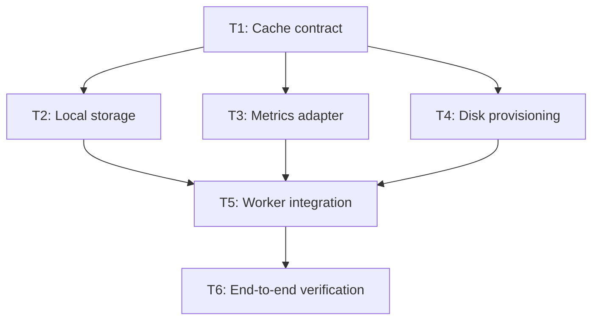

# Research: Planning Parallel Coding-Agent Work in Large Codebases (2026)

**Research date:** 2026-10-30  
**Scope:** Planner agents, task decomposition, dependency graphs, Git worktrees, integration, verification, and large repositories.  
**Status:** Research complete; recommendations not implemented.

## Question

How should an agentic planner decompose a large feature into smaller tasks that independent coding agents can implement concurrently in Git worktrees, while preserving correctness and maintainability in an established codebase?

## Bottom line

**Recommendation (synthesis, not a universal industry standard):** Use a repository-aware planner to produce a dependency DAG of bounded, independently verifiable *behavioral slices*. Resolve shared contracts before dependent implementations, reserve conflicting write surfaces, run only unblocked tasks in separate worktrees, and integrate each result as it completes. Keep worktree management, DAG validation, scheduling, and merge gates deterministic. Replan affected unfinished work when evidence changes.

Optimize **accepted, integrated behavior per elapsed hour**, not task count, agent count, token throughput, or raw commits. Parallelism helps only when coordination and integration cost less than the time saved.

## Primary industry findings

| Source | Observed practice | Implication for a planner |
| --- | --- | --- |
| [Cursor, Scaling long-running autonomous coding (Jan 2026)](https://cursor.com/blog/scaling-agents) | Separates planners from workers, gives workers bounded ownership, and avoids an undirected peer-to-peer locking scheme that created contention. | Assign a single owner to the feature and each task. Do not make workers negotiate task boundaries. |
| [Cursor, Towards self-driving codebases (Feb 2026)](https://prod.cursor.com/blog/self-driving-codebases) | Uses root planners, scoped subplanners, isolated workers, structured handoffs, and continuous reprioritization. Reports that static plans and overloaded executor roles caused failures. | Separate planning from implementation and allow targeted replanning. Recursive subplanning is an optional scale-up, not a starting requirement. |
| [OpenAI, Symphony](https://openai.com/index/open-source-codex-orchestration-symphony/) | Uses task trees with explicit blockers; starts tasks when DAG prerequisites are satisfied and continuously manages task state. | Treat the task graph as executable scheduling data, not merely prose. |
| [GitHub Copilot, Delegating and parallelizing work](https://docs.github.com/en/copilot/concepts/agent-capabilities/choosing-and-delegating-agent-work/delegating-and-parallelizing-work-with-agents) | Planner/orchestrator identifies subtasks and dependencies, delegates focused work, and combines results. Warns about cost and tasks that are not truly independent. | Make a no-parallelism decision valid when decomposition would increase overhead. |
| [Anthropic, Agent teams](https://code.claude.com/docs/en/agent-teams) | Recommends self-contained tasks, sufficient task context, distinct ownership, and a modest initial team size; automatic task dependencies are supported. | Start with a small concurrency cap and choose task size by deliverable and coordination cost. |
| [OpenAI, Harness engineering](https://openai.com/index/harness-engineering/) | Uses concise repository navigation, mechanized architectural invariants, and worktree-specific runnable environments. | Supply a repository map and enforce architecture and verification with tools, not just prompts. |
| [Git, worktree documentation](https://git-scm.com/docs/git-worktree) | Multiple branches can be checked out in separate working trees with distinct indexes and HEADs. | Worktrees isolate local edits; they do **not** make overlapping code changes semantically independent or guarantee conflict-free integration. |

**Evidence limitation:** Cursor's highest-throughput results are research experiments, not controlled proof of the best settings for every production repository. Vendor recommendations are practitioner guidance. Benchmark the design on representative `brain`/`loop` tasks before imposing hard thresholds.

## Decomposition method

1. **Inventory the requested behavior.** Read requirements, rules, edge cases, acceptance criteria, relevant artifacts, and existing tickets. Preserve user-defined decisions; flag unresolved contradictions.
2. **Map the existing implementation.** Locate affected modules, entry points, callers, domain contracts, persistence and external boundaries, composition roots, tests, architecture decisions, and similar solutions. Read only the relevant material.
3. **Find implementation seams.** Prefer narrow complete behaviors (vertical slices) over arbitrary file groups or a fixed task per architectural layer. A slice may cross layers within one owned module.
4. **Identify shared prerequisites.** API types, schema changes, behavior contracts, migrations, common scaffolding, and integration boundaries may need one preceding task. Avoid splitting two workers around an unstable interface.
5. **Create bounded task contracts.** Each must define objective, scope, acceptance, relevant artifacts, test seam, expected ownership, blockers, and a handoff. Do not force an arbitrary line-count target; split when a task cannot be understood or verified independently.
6. **Derive hard blocker edges.** Add an edge only if the consumer cannot be correctly implemented or validated against the current base without the producer. Similarity, shared reads, and an agent-capacity limit are not dependencies.
7. **Detect write conflicts separately.** Predict touched files/modules, shared registries, configuration and generated files. Concurrent tasks should not modify the same owned surface. A conflict can be resolved by moving the shared edit into one task, merging slices, or serializing execution; it should not become a fake semantic dependency.
8. **Validate before dispatch.** Check DAG acyclicity, requirements coverage, no unowned shared write surface, feasible verification, and actionable acceptance criteria. Flag no-safe-parallelism explicitly.
9. **Revise on evidence.** A new API requirement, unexpected shared file, or worker finding may change unfinished tasks. Preserve completed work, stable task identities, and the execution ledger.

### Vertical versus horizontal splitting

**Poor default:** create one task each for entities, repositories, services, controllers, and tests. These stages may be strongly coupled, and one change can invalidate all others.

**Better default:** create independently verifiable user-visible or domain capabilities. Define shared contracts first when necessary, then execute separate capabilities against those contracts. Tests accompany each behavior task; a final integration task verifies their composition.

**Exception:** horizontal splits can be useful for genuinely independent module migrations, mechanical repository-wide changes, or stable interface implementations. Choose them based on coupling and ownership, not a universal rule.

## Task graph example

Illustrative journal-cache feature, assuming the contract is stable after T1:



T2, T3, and T4 may run in different worktrees at the same time **only if** their write ownership and external assumptions do not overlap. If disk provisioning has no contract dependency, T4 should be a root task instead. The planner must derive, not assume, those edges.

### Minimal task contract

```yaml
id: T2
title: Implement local journal cache storage
goal: Implement local cache storage against the agreed contract.
depends_on: [T1]
ownership:
  modules: [Workers.JournalCache]
  expected_paths: [src/Workers/JournalCache/**]
constraints:
  - Reuse existing storage utilities.
  - Preserve architectural layering and failure fallback.
acceptance:
  - Objects can be cached and retrieved by key.
  - Concurrent requests for the same object are safe.
  - Cache failure falls back to remote storage.
verification:
  - Focused unit and affected component tests.
handoff:
  - Commit SHA and changed paths
  - Executed checks with outcomes
  - Deviations, blockers, and discovered dependencies
```

`expected_paths` is a prediction, not an invitation to change code outside ownership. Unexpected shared edits must be reported and reassigned before simultaneous work continues. Acceptance should describe observable behavior; implementation details belong in constraints and context.

## Planner, scheduler, implementer, and integrator boundaries

| Role | Owns | Does not own |
| --- | --- | --- |
| Planner | Requirement coverage, codebase exploration, task contracts, blocker graph, write-conflict prediction, critical path | Editing implementation code or managing worker processes |
| Scheduler/orchestrator | DAG validation, state, slots, worktree creation, task dispatch, retries, ledger | Inventing product requirements or architectural decisions |
| Implementer | One ticket's change, focused tests, commit, evidence handoff | Other workers' tickets, global scheduling, direct merge to main |
| Integration workflow | Serialized inclusion of completed changes and post-merge checks | Silently widening a worker's scope |
| Verifier | Integrated acceptance evidence and gaps | Treating worker self-reports as proof without checking |

The task graph should be machine-readable. The scheduler can use topological readiness, a bounded concurrency limit, file-conflict exclusions, and critical-path priority. It should integrate a finished task as soon as its checks settle without waiting for the rest of a fixed wave. A blocked dependent starts only after the prerequisite is **integrated and verified**, not merely after its worker finishes.

Keep a separate integration branch and one worktree/branch per in-flight task. Start each task from the appropriate integrated base. Serialize cherry-picks or merges. Preserve worktrees and failure evidence on unresolved conflicts. Ensure worktree-local build outputs, ports, services, and test state do not collide; separate Git indexes alone do not isolate runtime resources.

### Worker and integrated verification

- **Worker gate:** Compile/test the smallest affected boundary, verify the task's acceptance behavior, and report executed, failed, unavailable, and skipped checks accurately.
- **Integration gate:** Build and test the affected combined behavior after each incorporation; run broader end-to-end and required CI checks before delivery.
- **Do not require a full solution test run after every trivial edit.** Also do not waive required verification for speed. Repeatedly broad tests consume time without necessarily improving the feedback per change.

Cursor's research found that insisting on total-repository correctness at every intermediate commit serialized high-concurrency work, but this is **not** a recommendation to deliver a red branch. Require a green release/PR gate. [Source](https://prod.cursor.com/blog/self-driving-codebases).

## Non-negotiable constraints for the planner

- **MUST** ground task boundaries, interfaces, and predicted paths in the actual base revision. *Rationale:* Invented interfaces create integration failure.
- **MUST** map every requirement and acceptance criterion to at least one task and a verification seam. *Rationale:* Decomposition must preserve scope.
- **MUST** distinguish blocker edges from concurrent write conflicts. *Rationale:* Different restrictions need different scheduling rules.
- **MUST** resolve shared contract dependencies before parallel consumers start. *Rationale:* Concurrent workers need compatible assumptions.
- **MUST** keep write ownership non-overlapping for in-flight tasks, even if a looser arrangement appears faster. *Rationale:* Worktrees do not eliminate merge conflicts.
- **MUST** preserve existing valid tickets and native blocker relations; only plan missing breakdown when authorized. *Rationale:* Prevent duplicate work and ticket churn.
- **MUST NOT** manufacture tasks to fill all worker slots, even if more concurrency looks faster. *Rationale:* Coordination can exceed speedup.
- **MUST NOT** turn advisory shared reads or a worker-cap limit into hard blocker edges. *Rationale:* False dependencies lengthen the critical path.
- **MUST** provide observable acceptance and verification instructions for every implementation task. *Rationale:* Workers need a reliable completion target.
- **MUST** retain completed work and its evidence when replanning affected unfinished tasks. *Rationale:* Preserve traceability and prevent repeated work.

## Anti-patterns and cautions

1. **Maximizing agents:** More processes can increase token costs, disk contention, parallel builds, and integration failures. Anthropic suggests starting with roughly 3–5 teammates for suitable work; a smaller solo-factory default is reasonable and should be measured.
2. **One giant planner/executor/reviewer:** Cursor found overloaded roles prone to missed tasks and premature completion. Delegate bounded implementation and deterministic control.
3. **Static upfront plan with no feedback:** New facts can invalidate the graph. Replan only affected unfinished nodes, not the entire initiative by default.
4. **Shared-file peer locking as the primary coordination model:** Cursor's early experiments saw locks become a bottleneck and failure source. Prefer ownership decisions in scheduling.
5. **Testing only at final merge:** Allows incompatible workers to proceed too long. Run focused worker checks and inexpensive integrated checks continuously.
6. **Independent test-writing task for every coding task:** May create duplicate or implementation-coupled tests. Usually include relevant tests with each behavior slice; separate independent black-box verification is complementary.

## Current `antshc/brain` implementation (inspected on main, 2026-10-30)

The repository already implements most of the recommended foundation. Do **not** rewrite these mechanisms based on generic advice:

| Existing artifact | Already present |
| --- | --- |
| [`implement-spec/agents/planner.md`](https://github.com/antshc/brain/blob/main/plugins/wf/skills/implement-spec/agents/planner.md) | Ticket graph, grounded path footprints, `file` versus `soft` conflicts, ready frontier, critical path, structured JSON, and no implementation edits. Planner publication is a narrow authorized exception. |
| [`references/breakdown.md`](https://github.com/antshc/brain/blob/main/plugins/wf/skills/implement-spec/references/breakdown.md) | Requirement coverage, source exploration, Concepts/ADRs, vertical tracer bullets, prefactoring, artifact mapping, Contracts Delta, and verification instructions. |
| [`SKILL.md`](https://github.com/antshc/brain/blob/main/plugins/wf/skills/implement-spec/SKILL.md) | Planner runs only when the spec has no native sub-issues; existing tickets reuse their graph. Integration worktree and task-specific worker launch contracts are defined. |
| [`references/parallel.md`](https://github.com/antshc/brain/blob/main/plugins/wf/skills/implement-spec/references/parallel.md) | Experimental parallel mode, default cap of three, conflict-aware ready selection, critical-path priority, asynchronous completion, serialized cherry-picks, post-merge checks, and frontier recalculation. |
| [`agents/implementer.md`](https://github.com/antshc/brain/blob/main/plugins/wf/skills/implement-spec/agents/implementer.md) | One ticket per worker, focused risk-based tests, integration boundary checks, one commit, and structured verification outcomes. |

### Candidate improvements (not yet changes)

1. **Benchmark the existing planner/scheduler before editing prompts.** It already distinguishes hard dependencies and write conflicts. Measure task duration, conflict precision, first-pass integration rate, and critical-path idle time.
2. **Make contract readiness more explicit where needed.** The breakdown already carries Contracts Delta and blockers. Check whether the current ticket graph consistently serializes genuine shared-contract prerequisites without over-serializing unrelated consumers.
3. **Support evidence-driven targeted replanning only if real failures warrant it.** Existing parallel mode recalculates conflict pairs and frontiers, but it does not describe a general mechanism to revise unfinished ticket scope when new architectural facts emerge. Any addition must preserve issue identities, user-authored text, and audit history.
4. **Keep scheduling deterministic.** Enhance Python graph validation or measurement before introducing new planner roles or complex negotiation protocols.
5. **Verify worktree environment isolation.** Check build output contention, test ports, containers, credentials, and ephemeral state in representative large solutions; worktrees isolate Git state, not all process state.

## Evaluation plan

Use a set of representative features, including one tightly coupled change with little safe parallelism, one modular feature with multiple independent slices, and one cross-cutting API migration. Compare sequential mode with the existing parallel mode and any proposed planner revision on equivalent base snapshots.

| Metric | Meaning |
| --- | --- |
| End-to-end time to accepted PR | Primary speed outcome |
| Critical-path duration and idle ready time | Quality of dependency and dispatch decisions |
| Write-conflict prediction precision/recall | Unnecessary serialization versus missed overlaps |
| Cherry-pick/rebase conflict rate | Actual mergeability |
| First-pass integrated test success | Compatibility of task contracts |
| Requirement/acceptance coverage | Completeness |
| Rework, retries, and replanning count | Wasted work and plan stability |
| Tokens, agent runtime, and build/test duration | Cost of parallelism |

**Decision rule:** Adopt a planner change only if it improves completed, verified throughput without increasing escaped defects or violating architectural and scope constraints. Do not infer success from a higher number of tasks or commits.

## Additional primary references

- [Anthropic, Building effective agents — orchestrator-workers pattern](https://www.anthropic.com/research/building-effective-agents)
- [Anthropic, How we built our multi-agent research system — delegation and coordination caveats](https://www.anthropic.com/research/multi-agent-research-system)
- [Claude Code, Common workflows — worktree sessions](https://code.claude.com/docs/en/common-workflows)
- [GitHub, Copilot custom agents and subagents](https://docs.github.com/en/copilot/how-tos/copilot-sdk/features/custom-agents)
- [OpenAI, Introducing the Codex app — worktrees and parallel agents](https://openai.com/index/introducing-the-codex-app/)
