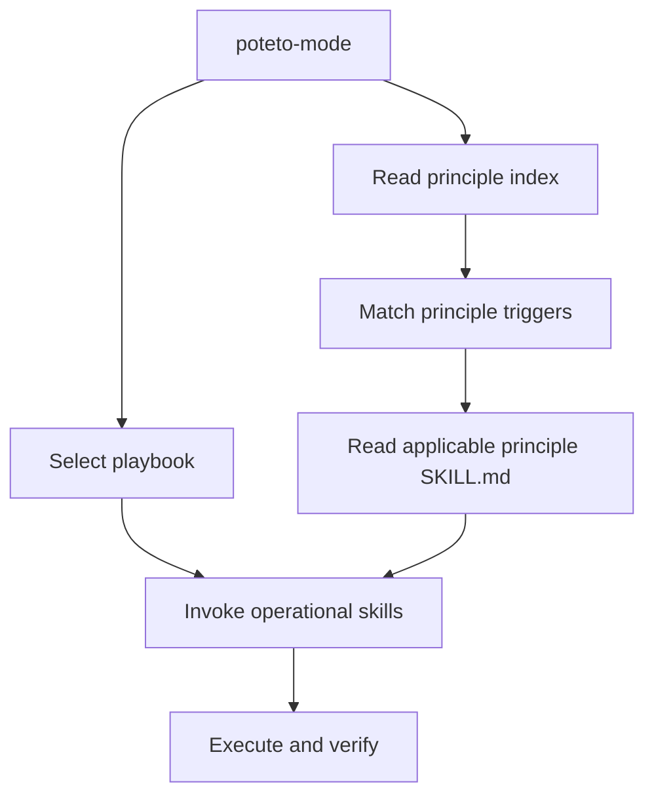
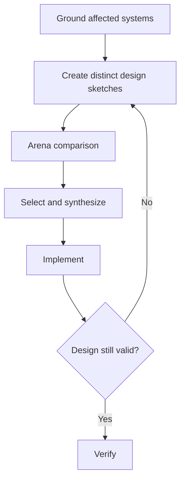

# pstack principles-to-skills mapping

Researched 2026-11-07. Source: [Cursor pstack](https://github.com/cursor/plugins/tree/6b0300214a09fd6029cfb7077043125758cd1fd2/pstack/skills), commit [`6b03002`](https://github.com/cursor/plugins/commit/6b0300214a09fd6029cfb7077043125758cd1fd2).

This report uses **only pstack's own skills, playbooks, and their referenced instructions**. It maps instructions, not runtime traces or confirmed agent executions.

| Component | Count |
| --- | ---: |
| Principle skills (`principle-*`) | 24 |
| Other standalone skills | 34 |
| Playbooks inside `poteto-mode` | 23 |
| **Standalone skills total** | **58** |

## 1. How principles apply

**Relationship types:**

- **E, explicit:** a skill/playbook names the principle as an instruction or directly invokes it.
- **B, behavioral:** the procedure implements the rule without explicitly invoking its separate skill.
- **—:** no corresponding relationship established from the inspected text. Does not imply incompatibility.
- **PB:** a `poteto-mode/playbooks/*.md` playbook, not a standalone skill.

Every principle appears in the `poteto-mode` index. That **does not** mean every principle is executed for every task. The index directs the agent to load a principle's leaf file in full when applicable. `poteto-help` catalogs the principles; `figure-it-out` explicitly reads the index.

## 2. All 24 principles to skills

### Core principles (10)

| # | Principle | Explicit consumers (E) | Behavioral consumers (B) | How used |
| --- | --- | --- | --- | --- |
| 1 | Laziness Protocol | `architect` (runner prompt), `arena`, `figure-it-out`; PB `feature`, `refactoring`, `hillclimb` | `tdd`, `no-comments` | Prefer the smallest effective change; reject speculative complexity. |
| 2 | Foundational Thinking | `architect`, `figure-it-out`; PB `refactoring` | PB `feature`; `statechart` | Choose data shape, ownership, and scaffold before logic. |
| 3 | Redesign from First Principles | `architect`, `arena`, `no-comments`; PB `refactoring` | — | Redesign an unsuitable shape instead of accumulating workarounds. |
| 4 | Attack the Premise | — | PB `bug-fix`, `hillclimb` | After two failed fixes sharing a premise, test that premise directly. |
| 5 | Subtract Before You Add | `architect`; PB `refactoring` | `no-comments`, `correct` | Delete obsolete code, validators, and indirection before replacement. |
| 6 | Minimize Reader Load | `architect` (runner prompt); PB `refactoring` | `no-comments` | Reduce call-chain depth and mutable context a reader must remember. |
| 7 | Outcome-Oriented Execution | `architect` | PB `refactoring`, `multi-phase-plan` | Converge on the target design through planned, scoped phases. |
| 8 | Experience First | — | PB `feature`, `prototype`, `visual-parity`; `make-bot-ui` | Prioritize a polished primary user workflow. |
| 9 | Exhaust the Design Space | `architect`; PB `prototype` | `arena`; PB `eval` | Compare structurally different candidates before choosing. |
| 10 | Build the Lever | PB `hillclimb`, `worktree-cleanup` | `blast-radius`, `create-verification-skill`; PB `trace-forensics` | Create a rerunnable script, generator, codemod, query, or verification harness. |

### Architecture principles (6)

| # | Principle | Explicit consumers (E) | Behavioral consumers (B) | How used |
| --- | --- | --- | --- | --- |
| 11 | Model the Domain | `poteto-mode`; PB `feature`, `refactoring` | `statechart`, `architect` | Encode state and rules in models, state machines, tables, or appropriate collections. |
| 12 | Boundary Discipline | `architect` (runner prompt), `typescript-best-practices` | `create-verification-skill`, `make-bot-ui` | Parse/validate at system edges; trust domain types internally. |
| 13 | Type System Discipline | `typescript-best-practices` | `architect`, `correct` | Model semantic identities, legal variants, and schema-derived types. |
| 14 | Make Operations Idempotent | `architect` (runner prompt) | PB `autonomous-run`, `babysit`, `orchestrate` | Repeated or interrupted operations converge safely. |
| 15 | Migrate Callers Then Delete Legacy APIs | PB `refactoring` | PB `multi-phase-plan`, `babysit` | Move consumers and remove obsolete internal APIs in a coordinated wave. |
| 16 | Separate Before Serializing Shared State | `arena`, `figure-it-out`, `architect` (runner prompt); PB `feature`, `hillclimb`, `visual-parity` | `swarm`; PB `orchestrate`, `autopilot-full` | Give parallel writers different ownership; serialize only when sharing is essential. |

### Verification principles (5)

| # | Principle | Explicit consumers (E) | Behavioral consumers (B) | How used |
| --- | --- | --- | --- | --- |
| 17 | Prove It Works | `arena`, `figure-it-out`; PB `hillclimb`, `refactoring`, `multi-phase-plan`, `session-pickup`, `worktree-cleanup` | `blast-radius`, `interrogate`, `tdd`, `statechart`; PB `shipping` | Execute the real artifact and inspect observed results, not self-reports. |
| 18 | Fix Root Causes | `architect`, `no-comments` | PB `bug-fix`, `runtime-forensics`, `trace-forensics`; `tdd` | Trace to the first incorrect decision or genuinely unhandled state. |
| 19 | Sequence Verifiable Units | `figure-it-out`; PB `bug-fix`, `feature`, `refactoring`, `perf-issue`, `hillclimb`, `autonomous-run`, `multi-phase-plan` | PB `orchestrate`, `shipping` | Verify an atomic unit before beginning the next. |
| 20 | Test Behavior, Not Implementation | — | `tdd`, `correct`, `create-verification-skill`, `maintain-verification-skill` | Assert observable contracts; keep tests stable under equivalent refactors. |
| 21 | Explain the Number | — | `benchmark-checklist`; PB `perf-issue`, `hillclimb`, `eval` | Check limits, noise, error counts, workload and meaningful end-to-end effect. |

### Delegation principles (2)

| # | Principle | Explicit consumers (E) | Behavioral consumers (B) | How used |
| --- | --- | --- | --- | --- |
| 22 | Guard the Context Window | PB `hillclimb`, `multi-phase-plan`, `runtime-forensics`, `trace-forensics`, `session-pickup`, `worktree-cleanup` | `swarm`, `how`, `why`, `recall`; PB `orchestrate` | Delegate bulk reading; return small evidence summaries and file references. |
| 23 | Never Block on the Human | `figure-it-out`; PB `multi-phase-plan` | `poteto-mode`; PB `autonomous-run`, `orchestrate` | Proceed on reversible execution; preserve irreversible/product-choice gates. |

### Meta principle (1)

| # | Principle | Explicit consumers (E) | Behavioral consumers (B) | How used |
| --- | --- | --- | --- | --- |
| 24 | Encode Lessons in Structure | `architect` (runner prompt), `reflect`, `show-me-your-work`, `figure-it-out`; PB `authoring-a-skill`, `multi-phase-plan`, `worktree-cleanup` | `correct`, `automate-me` | Replace repeated instructions with types, scripts, checks, metadata, or lint. |

## 3. All 34 operational skills to principles

Principle numbers refer to section 2. The B column is an interpretation of **actual pstack procedures**, not a claim of a separate skill invocation.

| Skill | E | B | What it does |
| --- | --- | --- | --- |
| `architect` | 1, 2, 3, 5, 6, 7, 9, 12, 14, 16, 18, 24 | 11, 13 | Ground the subsystem; compare sketches; implement or rework the shape. |
| `arena` | 1, 3, 16, 17 | 9 | Isolated candidate attempts, independent judging, synthesis, verification. |
| `automate-me` | — | 24 | Encode observed working preferences as a personal skill. |
| `benchmark-checklist` | — | 17, 21 | Vet load, limits, noise, work counts, and performance measurements. |
| `blast-radius` | — | 10, 17 | Find downstream risks and execute a test of the key safety fact. |
| `bro` | — | — | Rewrite a prior response in plain language. |
| `correct` | — | 11, 13, 20, 24 | Prevent recurring mistakes through architecture, types, lint, and tests. |
| `create-formal-verification-skill` | — | 11, 17, 20 | Produce reproducible checks of bounded invariants and state behavior. |
| `create-verification-skill` | — | 10, 17, 20 | Generate a project-local harness that drives the real application. |
| `figure-it-out` | 1, 2, 16, 17, 19, 23, 24 | 22 | Design an auditable workflow when no playbook fits. |
| `how` | — | 2, 11, 22 | Explain subsystem ownership, architecture, and runtime flow. |
| `in-your-own-words` | — | — | Restate the goal and problem before execution. |
| `interrogate` | — | 17 | Adversarially review a change; retain only proven findings. |
| `ketchup` | — | — | Summarize chat progress and decisions awaiting the operator. |
| `ketchup-video` | — | — | Produce a short video recap of the conversation. |
| `maintain-formal-verification-skill` | — | 17, 20 | Reconcile the formal check with changed code and rerun. |
| `maintain-verification-skill` | — | 17, 20 | Update the feature map/harness and execute a full live pass. |
| `make-bot-ui` | — | 8, 12 | Build the interface and webhook integration. |
| `no-comments` | 3, 18 | 5, 6 | Remove unnecessary commentary and in-scope workarounds. |
| `poteto-help` | all 24 indexed | — | Catalog/route principles, playbooks, and skills; no universal execution. |
| `poteto-mode` | all 24 indexed | — | Select playbook, match principle triggers, load leaf instructions. |
| `recall` | — | 22 | Reconstruct prior work from transcripts and live state. |
| `reflect` | 24 | — | Turn transcript learnings into focused skill edits. |
| `setup-pstack` | — | — | Configure per-role models and reasoning budgets. |
| `sharpen` | — | — | Improve the framing and verification criteria of a prompt. |
| `show-me-your-work` | 24 | 17, 19 | Log decisions, evidence, and outcomes for audit. |
| `statechart` | — | 11, 17, 20 | Check a TLA+ model; render states and invariant violations. |
| `swarm` | — | 16, 17, 22 | Partition independent tasks and aggregate reports. |
| `tdd` | — | 17, 18, 20 | Establish red-before-green behavioral regression evidence. |
| `teach` | — | — | Combine `how` and `why` into a plain explanation. |
| `technical-writing` | — | — | Apply a writing-specific documentation standard. |
| `typescript-best-practices` | 12, 13 | 11, 17 | Apply discriminated unions, branded types, boundary parsing, and real tests. |
| `unslop` | — | — | Remove generic AI writing patterns. |
| `why` | — | 22 | Investigate source and historical evidence for design rationale. |

## 4. All 23 playbooks to principles

These files are **not** additional standalone skills. E denotes a named principle reference in a playbook. The execution description is grounded in the playbook's steps.

| Playbook | E principles | Execution |
| --- | --- | --- |
| `investigation` | — | Run `how`, plus `why` for motivation; return an evidence-based answer. |
| `bug-fix` | 19 | Reproduce on the real surface, isolate the mechanism, fix, rerun, and order repro/fix commits. |
| `perf-issue` | 19 | Measure a vetted baseline; find the limiter; change; compare verified attempts. |
| `hillclimb` | 1, 10, 16, 17, 19, 22 | Freeze a sensitive harness; test and measure one hypothesis at a time. |
| `runtime-forensics` | 22 | Capture live runtime artifacts and isolate the mechanism. |
| `trace-forensics` | 22 | Transform large traces into queryable data and source-attributed findings. |
| `feature` | 11, 16, 19; mentions 1 as an exception | Design a data shape, delegate implementation, verify and commit small units. |
| `refactoring` | 1, 2, 3, 5, 6, 11, 15, 17, 19 | Pin behavior, redesign, subtract, migrate callers, and prove equivalence. |
| `prototype` | 9 | Build inexpensive alternatives to settle a real decision. |
| `visual-parity` | 16 | Isolate component changes and compare images against a baseline. |
| `authoring-a-skill` | 24 | Write/validate a reusable skill; do not duplicate structural sources. |
| `eval` | — | Use organic prompts, blinded candidates, judge output, and transcript evidence. |
| `babysit` | — | Resolve PR status, conflicts, review threads, and CI with bounded retries. |
| `shipping` | — | Verify PRs independently and merge only the contiguous verified run. |
| `opening-a-pr` | — | Publish scoped commits and real verification evidence. |
| `autonomous-run` | 19 | Iterate small verified changes until a checkable exit condition is met. |
| `orchestrate` | — | Coordinate independent owners, scoped tasks, evidence gates, and reviews. |
| `autopilot-full` | — | Parallel independent PRs, independent verification, controlled merging. |
| `autopilot-stack` | — | Build a dependent stack and stop at verified for operator landing. |
| `session-pickup` | 17, 22 | Restore operational context, route remaining work, verify inherited claims. |
| `pause-safely` | — | Finish an atomic step and preserve a recoverable state. |
| `multi-phase-plan` | 17, 19, 22, 23, 24 | Define checkable PR units and gates; validate the plan with a script. |
| `worktree-cleanup` | 10, 17, 22, 24 | Audit worktree usage with a script, check active work, clean safely. |

## 5. Principle-to-principle references

| From | To | Relationship |
| --- | --- | --- |
| Attack the Premise | Build the Lever | Make the premise test rerunnable. |
| Attack the Premise | Fix Root Causes | Continue tracing once the premise is tested. |
| Attack the Premise | Laziness Protocol | Remove the failed condition rather than compensating for it. |
| Build the Lever | Laziness Protocol | Prefer a minimal script to an unnecessary framework. |
| Build the Lever | Encode Lessons in Structure | Distinguish a task-specific lever from a durable correction guardrail. |
| Build the Lever | Prove It Works | Distinguish automation of work from verification of results. |
| Type System Discipline | Boundary Discipline | Parse external data before trusting domain types. |
| Type System Discipline | Encode Lessons in Structure | Derive types from authoritative schemas. |
| Sequence Verifiable Units | Prove It Works | Require a real check for each completed unit. |
| Sequence Verifiable Units | Build the Lever | Make repeated unit checks inexpensive. |
| Explain the Number | Prove It Works | Distinguish a credible measurement from a real observed output. |
| Minimize Reader Load | Guard the Context Window | Protect limited working memory, for code readers and agents respectively. |

A cross-reference provides guidance. It does **not**, by itself, prove that the other standalone principle skill is invoked.

## 6. Concrete execution examples

### Architect: Exhaust the Design Space

- **Explicit:** `architect` names `exhaust-the-design-space`.
- **Trigger:** nontrivial new shape or architecture decision.
- **Requirement:** at least two structurally distinct candidates before synthesis.
- **Evidence:** candidate sketches, rubric/synthesis, resulting verification.
- **Effect:** do not commit to the first plausible shape.

Source: [`architect/SKILL.md`](https://github.com/cursor/plugins/blob/6b0300214a09fd6029cfb7077043125758cd1fd2/pstack/skills/architect/SKILL.md).

### Refactoring: explicit multi-principle sequence

| Step | Principle | Decision |
| --- | --- | --- |
| 1. Capture behavior | Prove It Works (verification behavior) | Record a characterization test or equivalence baseline first. |
| 2. Choose new shape | Model the Domain | Find a structure that eliminates scattered decisions. |
| 3. Define target | Foundational Thinking, Redesign from First Principles | Name desired types, layout, and call graph. |
| 4. Simplify | Subtract Before You Add, Laziness Protocol | Delete dead structure; reject speculative cleanup. |
| 5. Move consumers | Migrate Callers Then Delete Legacy APIs | Update every caller and remove the old internal API. |
| 6. Verify | Prove It Works | Compare behavior on the real artifact. |
| 7. Evaluate complexity | Minimize Reader Load | Revert a reshape that does not reduce reader work. |
| 8. Deliver | Sequence Verifiable Units | Form small, independently verified commits. |

Source: [`refactoring.md`](https://github.com/cursor/plugins/blob/6b0300214a09fd6029cfb7077043125758cd1fd2/pstack/skills/poteto-mode/playbooks/refactoring.md).

### Blast Radius: Build the Lever is behavioral, not invoked

The `blast-radius` skill instructs the agent to:

1. Read the change and determine its actual effect.
2. Find the principal fact that would make the change safe.
3. Follow dependencies and downstream contracts missed by symbol search.
4. Assess confirmed and cleared risks.
5. Write and **run** a script or test against real code to prove that safety fact.
6. Report evidence, remaining risk, and the cheapest future regression check.

This implements part of **Build the Lever** (rerunnable verification) and **Prove It Works** (direct evidence). However, `blast-radius/SKILL.md` **does not explicitly instruct the agent to load either standalone principle skill**. A direct invocation of `blast-radius` is therefore not a guaranteed invocation of Build the Lever. When routed through `poteto-mode`, the principle may be loaded if its trigger applies.

Source: [`blast-radius/SKILL.md`](https://github.com/cursor/plugins/blob/6b0300214a09fd6029cfb7077043125758cd1fd2/pstack/skills/blast-radius/SKILL.md).

## 7. Findings

1. `poteto-mode` indexes all 24 principles, but loads them conditionally.
2. Named references are concentrated in `architect`, `figure-it-out`, and several playbooks, notably `refactoring`, `hillclimb`, and `multi-phase-plan`.
3. Some operational skills follow principles without importing or citing their leaf skills, including `blast-radius` versus Build the Lever.
4. The roles differ: **principle = decision rule; operational skill = procedure; playbook = execution order**.
5. A principle being named is not runtime evidence it was applied. Check the resulting artifact, test, code structure, or observation.

## Sources

- [`poteto-mode/SKILL.md`](https://github.com/cursor/plugins/blob/6b0300214a09fd6029cfb7077043125758cd1fd2/pstack/skills/poteto-mode/SKILL.md) — all principle triggers and routing.
- [`pstack/README.md`](https://github.com/cursor/plugins/blob/6b0300214a09fd6029cfb7077043125758cd1fd2/pstack/README.md) — skill and principle inventory.
- [`pstack/skills/`](https://github.com/cursor/plugins/tree/6b0300214a09fd6029cfb7077043125758cd1fd2/pstack/skills) — 58 standalone skill directories, including the 24 principle files.
- [`poteto-mode/playbooks/`](https://github.com/cursor/plugins/tree/6b0300214a09fd6029cfb7077043125758cd1fd2/pstack/skills/poteto-mode/playbooks) — 23 playbooks.
- [`architect/references/runner-prompt.md`](https://github.com/cursor/plugins/blob/6b0300214a09fd6029cfb7077043125758cd1fd2/pstack/skills/architect/references/runner-prompt.md) — additional explicit principle references used by architect runners.
