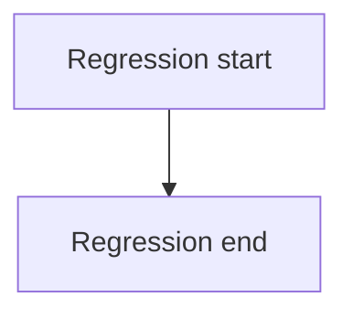
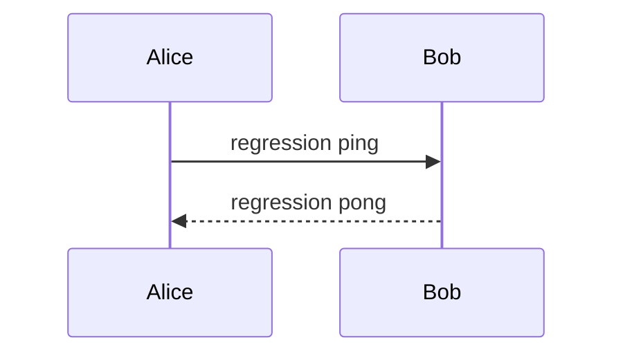

# ATL Round-Trip Regression

<!-- adf:toc -->

Purpose: one page exercising every `map-markdown-adf`, `publish-page`, and `fetch-page` capability.

<!-- adf:ignore:start -->
LOCAL-ONLY-NOTE: this block must never reach Confluence.
<!-- adf:ignore:end -->

## Inline Marks

Plain **strong text**, *emphasis text*, `inline code`, [plain link](https://example.com/plain), and ~~struck text~~.

Combined marks: [`Foo.Bar`](https://example.com/code-link) and **[bold link](https://example.com/bold-link)** and [label with **bold part** inside](https://example.com/partial).

Inline comment target: the regression anchor phrase sits here.

## Status Lozenges

Status row: ⚪[Neutral] 🟣[Purple] 🔵[Blue] 🔴[Red] 🟡[Yellow] 🟢[In Progress]

Legacy status syntax: [STATUS:Legacy Default] [STATUS:Legacy Green|green]

### Heading Level Three

#### Heading Level Four

##### Heading Level Five

###### Heading Level Six

## Lists

- bullet alpha
- bullet beta
  - nested bullet gamma
    - deep bullet delta
- bullet epsilon with a soft wrapped
  continuation line

3. ordered three
4. ordered four
   - mixed nested bullet

- list item owning a table

  | Moved Col A | Moved Col B |
  | --- | --- |
  | moved one | moved two |

## Blockquote And Panels

> Quoted line for the blockquote check.

> [!INFO]
> Info panel text.

> [!NOTE]
> Note panel text.

> [!WARNING]
> Warning panel text.

> [!SUCCESS]
> Success panel text.

> [!ERROR]
> Error panel text.

## Code Blocks

```python
def regression_python():
    return 42
```

```bash
echo regression-bash
```

<!-- adf:breakout mode="wide" width="1000" -->
```python
print("wide code block")
```

```
plain fenced block without language
```

```plaintext
plaintext fenced block
```

## Tables

| Header A | Header B |
| --- | --- |
| cell a1 | cell b1 |
| multi line<br>cell a2 | cell b2 |

<!-- adf:wide-table -->

| Wide Header A | Wide Header B | Wide Header C |
| --- | --- | --- |
| wide a | wide b | wide c |

<!-- adf:table layout="wide" width="960" -->

| Sized Header A | Sized Header B |
| --- | --- |
| sized a | sized b |

---

## Expand

<!-- adf:breakout mode="wide" width="760" -->
<details>
<summary>Wide Expandable Section</summary>

Wide expand body.
</details>

<details>
<summary>Expandable Section Title</summary>

Hidden paragraph inside the expand.

- hidden bullet one
- hidden bullet two
</details>

## Diagrams





## Attachments


<!-- media-size: width=64 height=32 display-width=48 layout=align-start -->

[regression-notes.txt](assets/regression-notes.txt)
