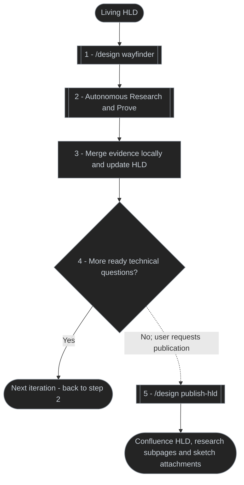

# Design skill

One discoverable entry point for code architecture, standalone code sketches, deep-module interfaces, decision interviews, high-level designs, specifications and tickets.

## Flows

### Architecture first

Best fit for a user story or task with clear requirements and no unresolved product or domain questions. Example: implement a functional slice from controller through application logic to the database, with behavior and contracts already defined.

### Interview first

Sketch and Tickets are optional. Ticket publication follows approval of the breakdown. Implement receives the spec URL, with its tickets when created.

### Living HLD

Dotted arrows are user-requested handoffs; solid arrows show work within the selected route or decision branch. The loop connector resumes autonomous evidence work without an upward edge.

For Architecture first, explicitly request a **design-only handoff** from Architect; otherwise it implements by default. Pass the accepted sketch/rationale to Spec, then the published spec URL to Implement. Each handoff follows the requested route; the diagrams do not run the whole chain automatically.

Wayfinder automatically dispatches ready in-scope Research/Prove work, merges verified artifacts locally, updates `docs/ongoing/<initiative-slug>.md`, and repeats as new questions emerge. Human choices remain interactive; risk verification may select Challenge this. Confluence publication requires an explicit `/design publish-hld` request; discovery performs no push or PR creation.

## Wayfinder: purpose and helpers

**Purpose:** Build a navigable path from an uncertain idea to a decision-ready, evidence-backed high-level design. Wayfinder maps known questions, dependencies, risks and emerging unknowns; selects the next useful investigation; and keeps one living HLD in `docs/ongoing/` aligned with verified findings and human decisions. It does not assume the full path is known upfront.

**Helpers and their intent**

| Helper | Use when | Intended contribution |
| --- | --- | --- |
| [Grill](playbooks/grill.md) | Requirements, priorities, trade-offs or acceptance need human judgment | Interview the user; surface assumptions and record explicit decisions and remaining questions |
| [Research](../research/SKILL.md) | The answer depends on existing code, system behavior, history, cloud services or external facts | Gather primary-source evidence and citations; narrow factual unknowns before choosing a design |
| [Challenge this](../challenge-this/SKILL.md) | A proposed design or mitigation may hide failure modes or interacting risks | Adversarially search for blind spots; keep only reproducible counterexamples, not speculative findings or fixes |
| [Prove](../prove/SKILL.md) | One technical claim, integration behavior or mitigation can be tested | Run the smallest meaningful check; return reproducible confirmed, refuted or inconclusive evidence within stated limits |
| [Deep module](playbooks/deep-module.md) | A new or changed contract, interface, inheritance shape or module seam needs a decision | Compare 3+ substantially different interface options and recommend a seam; the user selects the contract |
| [Code sketch](playbooks/sketch.md) | A proposed architecture needs concrete usage and type shapes before implementation | Illustrate caller usage, signatures, boundaries and module mapping in non-production source sketches |
| [Architect](playbooks/architect.md) | Broader code architecture or multiple structural candidates need exploration | Ground and compare architectural shapes, then synthesize an accepted sketch; request **design-only handoff** to avoid its default implementation |

**How Wayfinder uses them:** It automatically dispatches ready, in-scope factual Research and Prove work, chooses Challenge this for adversarial material-risk verification, and prepares Deep Module options for contract decisions. Grill obtains human decisions; contract selection, subjective trade-offs and scope changes never happen autonomously. Code Sketch and Architect are optional, explicitly requested design aids—not automatic Wayfinder ticket types. Architect's design-only handoff keeps discovery separate from production implementation.

Every verified result updates the HLD and its source-linked appendices; unresolved or partially verified risks remain in Open Questions with the mitigation, verification method, outcome and residual uncertainty. Research and proof artifacts merge **locally** into the Wayfinder integration branch. No automatic push, PR or Confluence publication. Use `/design publish-hld` explicitly to publish.

## Routes

| Request | Route | Outcome |
| --- | --- | --- |
| `/design architect design retries` | `architect` | Research, Arena sketch, evidence and verification, then implementation by default |
| `/design architect checkpoint design retries` | `architect` | Review the sketch before implementing or handing off |
| `/design architect arena-agents=2 design retries` | `architect` | Compare two independently drafted architecture shapes |
| `/design sketch add pagination to orders` | `sketch` | One usage-first design package, no production edits |
| `/design deep-module order pricing seam` | `deep-module` | Three or more interface options, comparison, recommendation |
| `/design hld` | `hld` | Authoritative high-level feature design, synthesized or merged in `docs/ongoing/` |
| `/design grill` / `/design spec` / `/design tickets` | Corresponding route | Decisions, spec or approved ticket breakdown |
| `/design wayfinder` | `wayfinder` | Living HLD and local evidence merges into its integration branch; no push or PR |
| `/design publish-hld` | `publish-hld` | Confluence HLD, research child pages, prototype and sketch attachments |
| `/design review` | `review` | Design-gap assessment |

Architect accepts `arena-agents=1|2|3` (default 1); Challenge this accepts `adversaries=1|2|3` (default 1). `checkpoint` requires explicit request. Explicit design-only handoff stops before implementation and returns the accepted `synthesis/` package to `design spec`.

Both `sketch` and `architect` use [one code-sketch contract](references/sketch-contract.md). The former makes one package; the latter uses that procedure for Arena candidates and synthesizes the selected package. Artifacts live under `<repo-root>/tmp/design-<slug>/` and the accepted package is always `synthesis/{sketch/,module-map.md,rationale.md}`.

See [Skill router](SKILL.md) and [Architect playbook](playbooks/architect.md). `design hld` owns of authoritative feature-design documents.

Use `/prove <claim>` for empirical evidence and `/challenge-this <scope>` for reproduced adversarial findings. Architect invokes these standalone skills as needed.

Record design risks in Open Questions. Select Prove for a specific claim or Challenge this for adversarial blind spots; each Answer records mitigation, actual verification method/result, evidence and residual risk or reason unproved.
