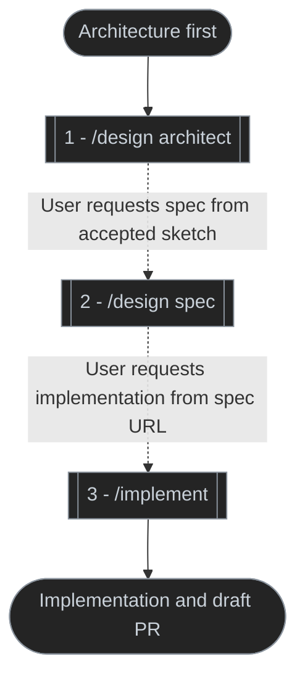
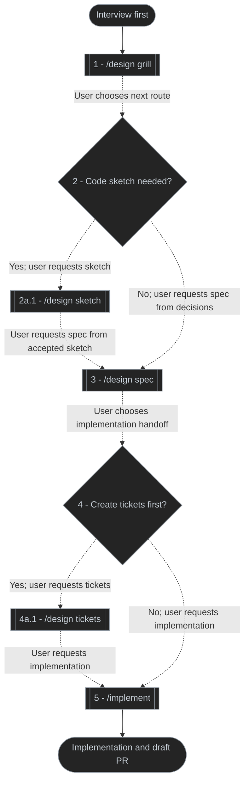
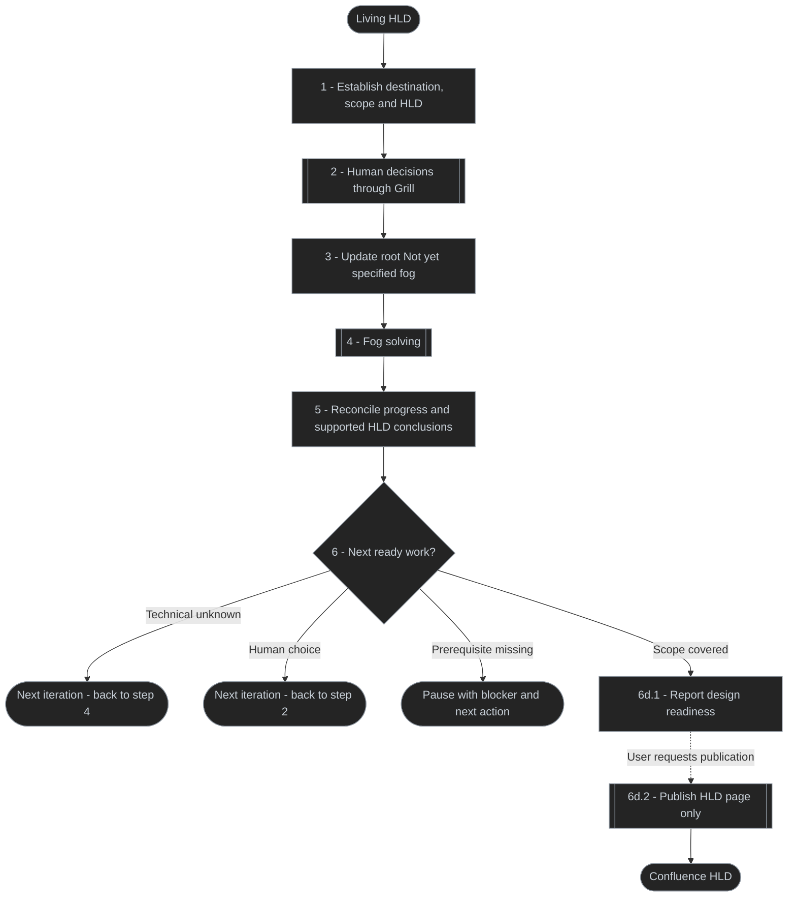
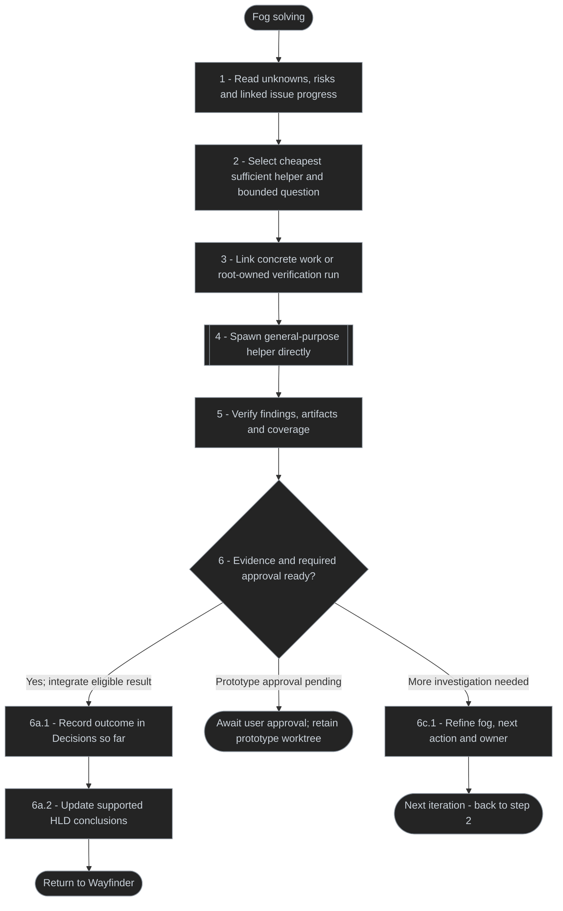
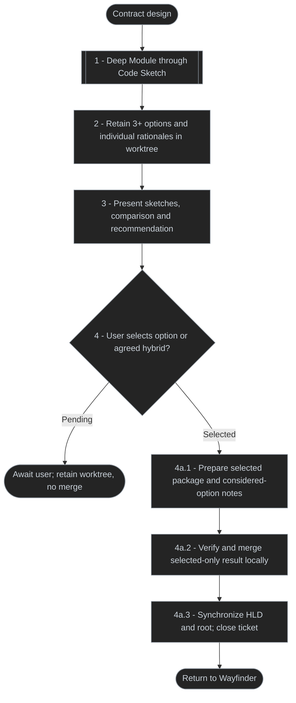

# Design skill

One discoverable entry point for code architecture, standalone code sketches, deep-module interfaces, decision interviews, high-level designs, specifications and tickets.

## Flows

### Architecture first

Best fit for a user story or task with clear requirements and no unresolved product or domain questions. Example: implement a functional slice from controller through application logic to the database, with behavior and contracts already defined.

### Interview first

Sketch and Tickets are optional. Ticket publication follows approval of the breakdown. Implement receives the spec URL, with its tickets when created.

### Alternating loop

Wayfinder charts the path from uncertain idea to supported HLD. Every Grill answer or helper result can reveal more unknowns; control returns to Wayfinder to select useful technical investigation or the next human choice.

Solid edges are work within Wayfinder; dotted edges require a separately requested handoff. Repeat connectors resume the numbered step. User answers are explicit; only the user ends Grill. Prove/Experiment and sketch prototype artifacts enter integration/HLD after explicit payload approval; Challenge this evidence updates root fog/HLD automatically without approval. Contract design additionally requires Choice.

### Fog solving

Research clarifies facts, Prove checks a claim, Challenge this seeks reproduced failures, Deep Module/Code Sketch expose interface and code shapes, and Grill settles human choices. These are alternatives and follow-ups, not a mandatory sequence. Challenge this may target the whole HLD; record it on the existing issue/root, never its own tracking ticket. A bounded passing check clears only its supported claim after required approval/integration; residual risks remain in fog. Prototype approval gates Prove/Experiment, Code Sketch and Contract payloads. Challenge this requires no approval: code changes or tests run in an owned result worktree, followed by automatic evidence integration and root fog/HLD updates. For approval-gated prototypes, retain the owned worktree and open issue/root state until the user approves the exact revision; Research and Challenge this integration remain automatic.

### Contract design

Contract design keeps its `wayfinder:contract-design` ticket across AFK Options and HITL Choice. Each option contains `sketch/`, `module-map.md` and its own Markdown `rationale.md`; `comparison.md` compares, never replaces, those rationales. Merge after user selection only: chosen source sketches/rationale plus notes describing considered alternatives and rejection reasons. Rejected source trees stay out of incoming integration history. Code Sketch Tasks use the same prototype approval gate before local integration.

## Key decisions

| Decision | Purpose |
| --- | --- |
| Alternate human decisions and autonomous helpers | Answers and findings can reveal more work; Wayfinder keeps control |
| Root Not yet specified is the fog of war | One home for unknowns/risks, coarse or precise, until resolved |
| Child issues track concrete work | Progress, claims and dependencies stay distinct from design uncertainty |
| Approve Prove/Experiment and sketch prototypes before integration | Retain its owned worktree, paths and reviewed revision; merge only the explicitly approved payload |
| Keep Contract design Options → Choice | Agent prepares options; user selects; only then merge chosen artifacts and considered-option notes |
| Challenge this is embedded and automatic | Verify scoped design or whole HLD without approval; isolate code changes/tests, then update fog/HLD |
| Direct general-purpose subagents | Random latest supported Opus/Sol, medium thinking; no Subagents skill |
| Git skill owns worktrees | Isolate gated prototypes and Challenge this code changes/tests; Wayfinder owns commits and serialized local integration |
| HLD contains supported conclusions | Open Questions belong to users during presentation; reports/sketches remain local |
| Explicit HLD-page-only publication | No evidence appendices, research subpages or report/sketch attachments |

## Responsibilities and handoffs

All delegated helpers use skill-capable general-purpose subagents; these rows describe responsibilities, not worker types.

| Owner/helper | Responsibility | Returns to Wayfinder |
| --- | --- | --- |
| User | Scope, requirements, preferences, prototype approval, contract choice, residual-risk acceptance and publish request | Explicit decisions |
| Wayfinder | Fog, scheduling, claims, dispatch, human relay, verification, prototype approval relay, commits/local integration and HLD synchronization | Next investigation, human choice, readiness or precise blocker |
| Grill | One human decision at a time, session ledger and closing sweep | Actual user answers and new unknowns |
| Research | Facts from code, cloud, history and primary sources | Cited findings and limits |
| Prove | Smallest meaningful check of one claim | Reproducible confirmed/refuted/inconclusive evidence |
| Challenge this | Reproduce counterexamples; code changes/tests in owned worktree; no production fixes or own tracking issue | Automatic evidence integration and fog/HLD updates, no approval |
| Deep Module | Compare 3+ interface options through Code Sketch | Option packages, rationales and recommendation for human Choice |
| Code Sketch | Usage-first code shapes, module map and individual rationale | Source sketch package, no implementation |
| HLD authoring | Synthesize supported design conclusions, preserve user presentation questions | Updated design and remaining root gaps |
| Git skill | Verified branches, worktrees, selected-result integration and cleanup | Paths/refs/SHAs or recovery blocker |
| HLD publisher | Explicit Confluence HLD-page create/update | Verified page URL; evidence remains local |

## Where state lives

| Location | Records |
| --- | --- |
| Root Not yet specified | Stable unknown/risk IDs, state, resolution criteria, linked work, evidence/limits, next action and owner |
| Child issues | Concrete progress, blockers, claims, worker/model, result/worktree/commit identities and resolution comments |
| Root Decisions so far | Supported resolved outcomes; clear active fog only after recording the outcome |
| Local `docs/research/` and `docs/prototype/` | Research/proof evidence, chosen sketch packages and considered-option notes |
| HLD `docs/ongoing/<initiative-slug>.md` | Supported current design and ignored local provenance; no evidence appendices |
| HLD Open Questions | User-filled presentation questions; agents preserve entries and blank answers |

For each helper spawn, randomly choose Opus or Sol with equal probability, resolve the latest host-supported model and use medium thinking. Current repository names: `claude-opus-5.5`, `gpt-6.1-sol`; verify availability at execution. Forward the [Wayfinder direct-spawn policy](playbooks/wayfinder.md#helper-dispatch) to nested helpers without loading the Subagents skill. Research and read-only Challenge this inspection may reuse a pinned checkout. Prove/Experiment and sketch prototypes use Git-skill worktrees; Challenge this code changes or tests also require one. Producers do not commit/push. Wayfinder retains approval-gated prototypes without commit/merge until explicit approval of the exact reviewed payload, then integrates locally; Contract design also requires Choice. Challenge this evidence integrates automatically and updates fog/HLD without approval. Changes need renewed approval; silence or passing checks do not approve a prototype. Resume retains the same worktree and pending step; cleanup waits for verified integration, HLD/tracker synchronization and every consumer.

Discovery creates no push/PR or publication. Explicit `/design publish-hld` publishes the HLD page only; reports, proof artifacts and sketch packages remain local, without appendices, subpages or artifact attachments. Existing remote artifacts are not automatically deleted. Architect is outside Wayfinder; Architecture first remains a separate flow. For that flow, request a **design-only handoff** explicitly; Architect otherwise implements by default.

## Routes

| Request | Route | Outcome |
| --- | --- | --- |
| `/design architect design retries` | `architect` | Research, Arena sketch, evidence and verification, then implementation by default |
| `/design architect checkpoint design retries` | `architect` | Review the sketch before implementing or handing off |
| `/design architect arena-agents=2 design retries` | `architect` | Compare two independently drafted architecture shapes |
| `/design sketch add pagination to orders` | `sketch` | One usage-first design package, no production edits |
| `/design deep-module order pricing seam` | `deep-module` | Three or more interface options, comparison, recommendation |
| `/design hld` | `hld` | Authoritative high-level feature design, synthesized or merged in `docs/ongoing/` |
| `/design grill` / `/design spec` / `/design tickets` | Corresponding route | Decisions, spec or approved ticket breakdown |
| `/design wayfinder` | `wayfinder` | Living HLD and local evidence merges into its integration branch; no push or PR |
| `/design publish-hld` | `publish-hld` | Confluence HLD page only; evidence remains local |
| `/design review` | `review` | Design-gap assessment |

Architect accepts `arena-agents=1|2|3` (default 1); Challenge this accepts `adversaries=1|2|3` (default 1). `checkpoint` requires explicit request. Explicit design-only handoff stops before implementation and returns the accepted `synthesis/` package to `design spec`.

Both `sketch` and `architect` use [one code-sketch contract](references/sketch-contract.md). The former makes one package; the latter uses that procedure for Arena candidates and synthesizes the selected package. Artifacts live under `<repo-root>/tmp/design-<slug>/` and the accepted package is always `synthesis/{sketch/,module-map.md,rationale.md}`.

See [Skill router](SKILL.md) and [Architect playbook](playbooks/architect.md). `design hld` owns of authoritative feature-design documents.

Use `/prove <claim>` for empirical evidence and `/challenge-this <scope>` for reproduced adversarial findings. Architect invokes these standalone skills as needed.

Record unknowns and risks in root Not yet specified. Select Prove for a claim or embedded Challenge this for blind spots; record actual method/result, mitigation evidence and residual risk/next action there. Preserve HLD Open Questions for users during presentation.
