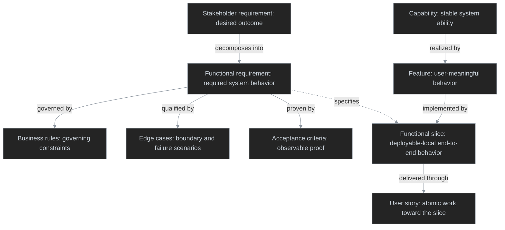

# Requirements

Normalize authored behavioral requirements in specifications and HLDs, and statements of required behavior in TOI documents. Preserve HLD decisions, responsibilities, contracts and evidence, and TOI descriptions of implemented behavior.

## Protected content

Preserve authoritative verbatim source text and identifiers; report implementation leaks in protected source text as source conflicts. Keep technical decisions, structural relocation paths/symbols/project references, contracts, reproduction steps, observations and evidence exact. Never invent requirements, constraints, facts or expected outcomes.

## The rule

Name a **behavior and entity**: what the system does and the actor's outcome, never its implementation (widget, screen, table, endpoint, flag, access role). Apply to behavioral **capability titles**, **feature descriptions**, **functional slice descriptions**, **stakeholder requirements**, **functional requirements**, **business rules**, **edge cases**, **acceptance criteria** and behavioral constraints.

## Preserve requirement structure

Keep this requirement structure intact while normalizing:

```text
Stakeholder requirement
 ↓
Functional requirement
 ├── Business rules
 ├── Edge cases
 └── Acceptance criteria
```

- A **Stakeholder requirement** states the desired outcome: *An administrator can control session lifetime.*
- A **Functional requirement** states the required system behavior: *The system lets an administrator configure session lifetime.*
- A **Business rule** states the governing constraint: *Session lifetime must be from one hour through 30 days.*
- An **Edge case** states a boundary, unusual, failure, or exceptional scenario: *A configured session lifetime is zero, absent, expired, or changes while sessions are active.*
- An **Acceptance criterion** states observable proof: *When the administrator configures a session lifetime of zero, the system rejects it and explains the validation failure.*

Normalize each item at its existing level: preserve scope and hierarchy. Do not turn rules/edge cases into criteria, collapse criteria into requirements, or add implementation details to make criteria observable.

## Preserve the hierarchy



- A **Deployable** is an independently runnable or deployed production unit.
- A **Capability** is a stable, coarse-grained system ability. A Capability may be realized by multiple Features, and a Feature may contribute to multiple Capabilities.
- A **Feature** is a user-meaningful product behavior that delivers all or part of a capability.
- A **Functional slice** is an end-to-end implementation of one distinct behavior or outcome within one deployable; connected deployables own related slices linked by contracts.
- A **User story** is an atomic, testable unit of planned work that advances one Functional slice and traces to the Functional requirements and Acceptance criteria it addresses.

Do not replace a defined **Feature** or **Functional slice** with a generic capability, requirement, or story. Their names are domain terms when supplied by the glossary; scrub only leaked artifacts within their descriptions.

## The domain glossary exception

Use supplied **domain glossary** terms verbatim for entities, states and behaviors, even when they resemble artifacts. Every glossary-defined term is allowed domain language: do not de-reference it. Scrub terms absent from the glossary with the swap test and Requirements terms tables.

## The swap test

If swapping the UI or the technology would force a reword, the statement is over-specified. Apply the test to every line:

- Reject: *Surface active alerts in the page header* · *Manage tasks on the Monitoring page* · *Store the soft-delete flag*.
- Prefer: *Surface the count of active alerts* · *Manage tasks* · *Keep a deleted item recoverable for its retention window*.

## The de-referencing move

Raise artifacts **one level** to the behavior they enable; keep implementation in design:

1. Find the artifact term (a screen, column, endpoint, status flag, worker, access role).
2. Ask what the actor actually gets from it — what they perceive, can do, or are told.
3. Rewrite the statement as that behavior + entity; drop the artifact.

## Apply the de-referencing tables

**Always** apply the router's Requirements terms tables for UI, data, API, domain-state, process and access leaks.

## Output

Return text with every leak corrected, preserving structure, levels and relationships. Add a short correction note (each leaked term → behavior); no leaks → say so.
